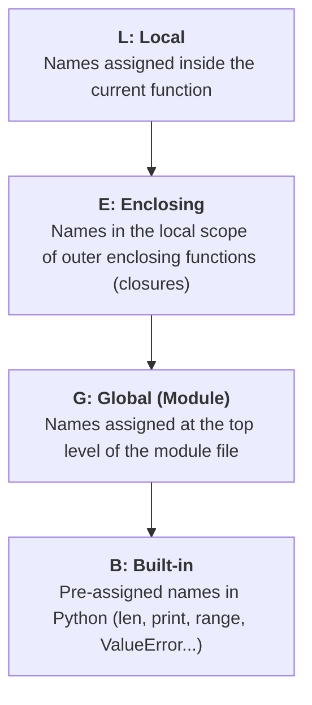

# Module 08: Functions, Scope, Parameter Mechanics & Functional Tools

> **BCPD Python Cohort 2 Certification Preparation**  
> **Source Screen Mappings:** `IMG-75` (Day 5 Agenda), `D5-01` to `D5-05` (Day 5 Slides), `D6-06`, `D6-07`, `D6-10` (Day 6 Slides)  
> **Classification:** `[Course Slide: D5-01 to D5-05, D6-06, D6-07, D6-10]` (100% Captured from Classroom Decks)  
> **Topic Classification:** Core Certification Subject & Domain 2 / Domain 3

---

## 1. Defining & Calling Functions `[Course: D5-01 / Beyond Manual Slide 8]`

Functions are defined with the `def` keyword, followed by the function name, parameter list in parentheses, a colon, and an indented block:

```python
def area(width, height):
    """Return the area of a rectangle."""
    return width * height

def greet(name):
    print("Hi", name)  # no return

print(area(3, 4))       # -> 12
result = greet("Ada")   # -> Hi Ada
print(result)           # -> None
print(area.__doc__)     # -> Return the area of a rectangle.
```

### Key Principles
- **Indented Body:** Python uses indentation to define the scope of the function body.
- **Immediate Exit:** `return` sends a value back and terminates function execution immediately.
- **Implicit `None` Return:** If a function has no `return` statement (or a bare `return`), the result is always `None`.
- **Docstrings (`__doc__`):** The first string literal immediately inside the function body is the docstring, accessible via `help(func)` or `func.__doc__`.

---

## 2. Parameter Mechanics & The Mutable Default Argument Trap `[Course: D5-02 / Slide 9]`

> [!CAUTION]
> ### The Mutable Default Argument Trap (The Classic Certification Pitfall!)
> **When defaults are made:** Default parameter expressions are evaluated **ONCE, when `def` runs**—not on every call.
>
> **Why it bites:** A mutable default (`list`, `dict`, `set`) is shared by every call that omits that argument!

### Verbatim Classroom Demonstration (`defaults.py`):
```python
# BUGGY: basket default is built ONCE
def add_item(item, basket=[]):
    basket.append(item)
    return basket

print(add_item("apple"))  # -> ['apple']
print(add_item("pear"))   # -> ['apple', 'pear']  <-- Previous list was reused!

# THE FIX: Default to None and create the object inside the function
def add_item_safe(item, basket=None):
    if basket is None:
        basket = []       # new list on every call
    basket.append(item)
    return basket

print(add_item_safe("apple"))  # -> ['apple']
print(add_item_safe("pear"))   # -> ['pear']     <-- Clean isolated list!
```

---

## 3. Variable Arguments: `*args` and `**kwargs` `[Course: D5-03 / Slide 10]`

Python allows functions to accept an arbitrary number of positional or keyword arguments:

```python
def total(*args):
    return sum(args)

def profile(name, **kwargs):
    print(name, kwargs)

print(total(1, 2, 3))                       # -> 6
print(total())                              # -> 0
profile("Ada", age=36, lang="py")           # -> Ada {'age': 36, 'lang': 'py'}
```

### Essential Rules
- `*args` collects extra positional arguments into an **immutable `tuple`**.
- `**kwargs` collects extra keyword arguments into a **mutable `dict`**.
- **Definition Order:** `normal_params, *args, keyword_only, **kwargs`.
- **Call Unpacking:** At a call site, `*` unpacks a sequence into positional arguments, and `**` unpacks a dictionary into keyword arguments:
  ```python
  nums = [4, 5]
  print(total(*nums))           # -> 9
  opts = {"age": 20}
  profile("Bo", **opts)         # -> Bo {'age': 20}
  ```
- *The names `args` and `kwargs` are conventions—the stars (`*`, `**`) do the actual work.*

---

## 4. Scoping Rules: LEGB, `global` & `nonlocal` `[Course: D5-04 / Slide 11]`

Variable names are looked up in strict sequential order:
```
Local -> Enclosing -> Global -> Built-in (LEGB)
```



### Classroom Code (`scope.py`):
```python
x = "global"

def outer():
    x = "enclosing"
    def inner():
        nonlocal x
        x = "changed"
    inner()
    return x

print(outer())  # -> changed (rebound in enclosing outer function)
print(x)        # -> global (module-level global untouched)

count = 0
def bump():
    global count
    count += 1

bump()
bump()
print(count)    # -> 2
```

### Core Scoping Rules
1. Assigning to a name inside a function makes it **local** by default.
2. Reading a global variable is fine; re-assigning to it requires an explicit `global` declaration.
3. `nonlocal` rebinds a name in the nearest **enclosing** function scope (closures).
4. **`UnboundLocalError`:** Accessing a local variable before assigning to it raises `UnboundLocalError: cannot access local variable 'x' where it is not associated with a value`.

---

## 5. Functional Tools: `map`, `filter` & `functools.reduce` `[Course: D6-06 / Manual §7.4]`

```python
from functools import reduce

nums = [1, 2, 3, 4]
print(list(map(lambda n: n ** 2, nums)))                   # -> [1, 4, 9, 16]
print(list(filter(lambda n: n % 2, nums)))                 # -> [1, 3]
print(reduce(lambda a, b: a * b, nums))                    # -> 24
print(list(map(str, nums)))                                # -> ['1', '2', '3', '4']
print(list(map(lambda a, b: a + b, [1, 2], [10, 20, 30]))) # -> [11, 22]
```

### Critical Functional Gotchas
- `map(func, iterable)` applies `func` to every item lazily. It has **no `len()`** and can be **consumed only once**:
  ```python
  m = map(abs, [-1, -2])
  print(list(m), list(m))  # -> [1, 2] []  (Exhausted!)
  ```
- Multi-sequence `map` stops at the shortest input iterable.
- `filter(predicate, iterable)` keeps items where `predicate(item)` evaluates to truthy.
- `reduce(func, iterable[, initial])` folds items into a single cumulative value.

---

## 6. Lambdas and Functions as Objects `[Course: D6-07 / Manual §7.4]`

Functions in Python are first-class objects: assign them, store them in data structures, and pass them as arguments:

```python
square = lambda x: x * x
print(square(6))  # -> 36

def apply(func, value):
    return func(value)

print(apply(str.upper, "hi"))       # -> HI
print(apply(lambda n: n + 1, 9))    # -> 10

words = ["kiwi", "fig", "banana"]
print(sorted(words, key=len))       # -> ['fig', 'kiwi', 'banana']
print(max(words, key=len))          # -> banana
```

### Lambda Rules
- Syntax: `lambda args: expression`.
- Builds an anonymous, in-line function.
- Contains a single expression whose result is returned implicitly; no statements (`return`, `for`, `pass`) are permitted.
- Common use: `key=` function for `sorted()`, `min()`, `max()`.

---

## 7. Recursion `[Course: D6-10 / Beyond Manual Slide 10]`

A recursive function calls itself on a smaller version of the problem:
```python
import sys

def factorial(n):
    if n <= 1:
        return 1  # base case that stops recursion
    return n * factorial(n - 1)

def fib(n):
    return n if n < 2 else fib(n - 1) + fib(n - 2)

def digit_sum(n):
    return n if n < 10 else n % 10 + digit_sum(n // 10)

print(factorial(5))            # -> 120
print(fib(10))                 # -> 55
print(digit_sum(1234))         # -> 10
print(sys.getrecursionlimit()) # -> 1000
```

### Recursion Rules
- Every recursive function requires a **base case** that stops it.
- The default recursion limit is typically **1000 calls**; deeper recursion raises `RecursionError: maximum recursion depth exceeded`.
- Great for divide-and-conquer and trees; loops are generally faster for simple counting.

---

## 8. Common Exam Traps & Gotchas Summary

1. **Mutable Default Argument Trap:** `def f(x, l=[])` retains accumulated state across calls.
2. **`*args` is a Tuple:** Cannot be mutated in-place; unpacked with `*`.
3. **`**kwargs` is a Dict:** Unpacked with `**`.
4. **`UnboundLocalError`:** Accessing a variable before assignment inside a function that binds that name.
5. **Map Exhaustion & No `len()`:** `len(map(...))` raises `TypeError`; map objects are consumed once.
6. **Recursion Limit:** Infinite recursion raises `RecursionError` (default limit `1000`).
