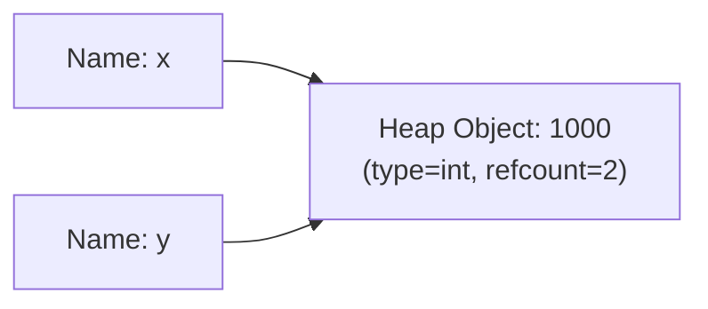

# Module 09: Supplementary Bridges — Object Model, Modules, and Exceptions

> **BCPD Python Cohort 2 Certification Preparation**  
> **Source Screen Mappings:** Previewed across `IMG-02, IMG-11, IMG-22, IMG-45, IMG-56, IMG-67, IMG-76, IMG-79`  
> **Classification:** `[Supplementary]` (Foundational bridge between Week 1 syntax and certification core)

---

## 1. The Python Object-Reference Model `[Supplementary]`

### Variables Are Pointers, Not Buckets
In C or Java, a variable is a typed memory bucket holding a value. In Python, **variables are names (tags) bound to objects living in heap memory**.

```python
x = 1000  # Creates int object 1000 in heap; binds name 'x' to it
y = x     # Binds name 'y' to the SAME int object
```



### Identity vs Equality
- `==`: Compares **values** (calls `__eq__`).
- `is`: Compares **object identities** (memory addresses via `id(x) == id(y)`).

### Caching and Interning Traps
CPython optimizes memory using pre-allocated singletons:
1. **Small Integer Caching:** Integers in the range `[-5, 256]` are pre-allocated at interpreter startup.
   ```python
   a = 250; b = 250
   a is b  # True (same cached object)

   c = 1000; d = 1000
   c is d  # False in REPL, may be folded if compiled in the same code object!
   c == d  # True (always use == for equality!)
   ```
2. **String Interning:** Compile-time string literals resembling identifiers are interned.
3. **Singletons:** `None`, `True`, `False`, and `Ellipsis` (`...`) are unique singletons; always compare using `is` (e.g., `if val is None:`).

---

## 2. Python Module System and Import Mechanics `[Course: IMG-56]`

### The Module Search Path (`sys.path`)
When executing `import my_module`, Python searches locations in this order:
1. The directory containing the input script (or current working directory).
2. `PYTHONPATH` environment variable directories.
3. Standard library directories (e.g. `math`, `os`, `sys`).
4. `site-packages` third-party packages installed via `pip`.

### Import Syntax Variants
```python
import math               # Preferred: qualified namespace (math.sqrt(4))
from math import sqrt     # Imports sqrt directly into current namespace
from math import sqrt as s # Alias
from math import *        # ANTI-PATTERN: Pollutes namespace, risks subtle shadowing
```

### The `__name__ == "__main__"` Idiom
Every Python module has a built-in string variable `__name__`:
- When executed directly from the terminal (`python my_script.py`), Python assigns:
  `__name__ = "__main__"`
- When imported by another file (`import my_script`), Python assigns:
  `__name__ = "my_script"`

```python
def solve():
    return 42

if __name__ == "__main__":
    # Runs ONLY when script is executed directly, not on import!
    print("Result:", solve())
```

### Bytecode and `__pycache__` `[Course: IMG-56]`
As noted in classroom lecture notes (`IMG-56`):
- When a module is imported, Python compiles it to bytecode (`.pyc`) stored in the `__pycache__/` directory.
- Bytecode accelerates import time on subsequent runs by skipping tokenization and parsing if the source file timestamp has not changed.

---

## 3. Exception Handling Fundamentals `[Course: IMG-22, IMG-45, IMG-67, IMG-76]`

Python uses structured exception handling to catch and recover from runtime errors.

### The Full `try / except / else / finally` Suite
```python
try:
    # 1. Code that may raise an exception
    num = int(input("Enter integer: "))
    result = 100 / num
except ValueError as e:
    # 2. Handled if input cannot be converted to int
    print("Invalid format:", e)
except ZeroDivisionError:
    # 3. Handled if user entered 0
    print("Cannot divide by zero!")
else:
    # 4. Executes ONLY if NO exception was raised in try block!
    print("Computation succeeded:", result)
finally:
    # 5. Executes UNCONDITIONALLY (even if return/break/unhandled error occurs)
    print("Cleanup actions completed.")
```

### Standard Exception Hierarchy
All standard exceptions inherit from `BaseException`:
```
BaseException
 ├── SystemExit
 ├── KeyboardInterrupt
 └── Exception (ALL normal program exceptions inherit from here!)
      ├── ArithmeticError
      │    └── ZeroDivisionError
      ├── LookupError
      │    ├── IndexError
      │    └── KeyError
      ├── ValueError
      └── TypeError
```

> [!WARNING]
> ### Bare `except:` Anti-Pattern
> Catching `except:` without an exception class or catching `BaseException` catches system termination signals like `KeyboardInterrupt` (`Ctrl+C`) and `SystemExit`, preventing the user from interrupting runaway scripts.
> **Certification Rule:** Always catch specific exceptions (e.g., `except (ValueError, KeyError):`) or at most `except Exception:`.

---

## 4. File I/O Operations & Stream Mechanics `[Course: IMG-45, IMG-76]`

Python manages file streams via the built-in `open(file, mode='r', buffering=-1, encoding=None)` function.

### File Access Modes Invariant Matrix
| Mode | Meaning | Creates if Missing? | Truncates to 0? | Initial Cursor Position | Read/Write Ability |
|:---:|:---|:---:|:---:|:---:|:---|
| `'r'` | Read (default) | ❌ (Raises `FileNotFoundError`) | ❌ | Start (byte 0) | Read only |
| `'w'` | Write | ✅ | ✅ (Destructive!) | Start (byte 0) | Write only |
| `'a'` | Append | ✅ | ❌ | End of file | Write only (forces write to end) |
| `'x'` | Exclusive Creation | ✅ (Raises `FileExistsError` if file exists) | ❌ | Start (byte 0) | Write only |
| `'r+'` | Read + Write | ❌ (Raises `FileNotFoundError`) | ❌ | Start (byte 0) | Read and Write |
| `'w+'` | Write + Read | ✅ | ✅ (Destructive!) | Start (byte 0) | Read and Write |
| `'a+'` | Append + Read | ✅ | ❌ | End for writes, Start for initial read | Read and Append |
| `'b'` | Binary Mode | (Suffix e.g. `'rb'`, `'wb'`) | - | - | Operates on `bytes`, not `str` |

> [!CAUTION]
> ### The Mode `'w'` Truncation Trap (Trap 9.4)
> `open("data.txt", "w")` executes an underlying OS `O_TRUNC` system call immediately upon opening. Any previous file content is erased to 0 bytes instantly, even if the program crashes or raises an exception before any `write()` call executes!

### Stream Cursor Navigation (`tell` & `seek`)
Files behave as sequential byte streams tracked by an internal cursor:
- `f.tell()`: Returns the current cursor position as an integer byte offset.
- `f.seek(offset, whence=0)`:
  - `whence=0` (`os.SEEK_SET`, default): Relative to the start of the file.
  - `whence=1` (`os.SEEK_CUR`): Relative to the current cursor position (binary mode only in Python 3).
  - `whence=2` (`os.SEEK_END`): Relative to the end of the file (e.g. `f.seek(0, 2)` jumps to end).

### Stream Reading Best Practices
1. **Never use `f.read()` on large files:** It loads the entire file into RAM at once, causing $O(N)$ memory bloat.
2. **Use line-by-line streaming:** `for line in f:` iterates lazily with $O(1)$ memory consumption via Python's internal read-ahead buffer.
3. **`f.readline()` vs `f.readlines()`:** `f.readline()` reads a single string ending in `\n`; `f.readlines()` reads all lines into a `list[str]`.

---

## 5. Context Managers & The Dunder Protocol `[Course: IMG-45]`

Manual file handling requires `try...finally` to ensure `f.close()` executes:
```python
f = open("data.txt", "r")
try:
    data = f.read()
finally:
    f.close()
```
The `with` statement encapsulates this cleanup pattern cleanly through the **Context Management Protocol**.

### The `__enter__` and `__exit__` Protocol
Any class implementing `__enter__` and `__exit__` can be used in a `with` statement:

```python
class ManagedResource:
    def __enter__(self):
        # 1. Setup resource
        print("Acquiring resource")
        return self  # Bound to target after 'as'

    def __exit__(self, exc_type, exc_val, exc_tb):
        # 2. Teardown / cleanup actions
        print("Releasing resource")
        # Returning True SUPPRESSES the exception!
        # Returning False (or None) allows the exception to propagate!
        return False
```

### Exception Suppression Mechanics (Trap 9.5)
- If an exception occurs inside the `with` block, Python passes its details to `__exit__(exc_type, exc_val, exc_tb)`.
- If `__exit__` returns a truthy value (e.g. `True`), Python **swallows the exception**; execution continues normally after the `with` block.
- If `__exit__` returns `False` or `None`, Python re-raises the exception up the call stack.

---

## 6. Advanced Exception Patterns & Subclass Masking `[Course: IMG-22, IMG-45]`

### Subclass Shadowing / Exception Masking (Trap 9.3)
Python tests `except` blocks sequentially from top to bottom using `issubclass()`. Catching a parent exception class before a child renders the child handler unreachable dead code:

```python
# BUG / EXAM TRAP:
try:
    d = {"name": "Alice"}
    print(d["missing_key"])
except LookupError:  # LookupError is the base class of KeyError & IndexError!
    print("Caught LookupError")  # Executes!
except KeyError:     # UNREACHABLE DEAD CODE!
    print("Caught KeyError")
```

### Multi-Exception Tuple Syntax (Trap 9.6)
When catching multiple exceptions in a single handler:
```python
# CORRECT:
except (ValueError, TypeError) as err:
    print("Caught:", err)

# SYNTAX ERROR IN PYTHON 3 (when using 'as'):
except ValueError, TypeError as err:  # SyntaxError!
    ...

# RUNTIME TYPE ERROR (cannot use list/set):
except [ValueError, TypeError]:  # TypeError at runtime!
    ...
```

---

## 7. Common Exam Traps & Gotchas Summary

1. **`is` vs `==` on Integers / Floats (Trap 1.19):** Never use `is` to check numerical equality; caching boundaries make it non-deterministic across Python implementations.
2. **`else` Block in Exceptions (Trap 9.2):** The `else` clause in a `try` statement only runs if the `try` block ran to completion **without** raising an exception.
3. **`finally` Always Runs (Trap 9.1):** Even if a `try` or `except` block contains an explicit `return` statement, the `finally` block executes before the function exits.
4. **Exception Hierarchy Masking (Trap 9.3):** Placing parent classes (`LookupError`, `ArithmeticError`, `Exception`) ahead of child classes (`KeyError`, `ZeroDivisionError`) masks the children as dead code.
5. **Mode `'w'` Immediate Truncation (Trap 9.4):** Opening an existing file in `'w'` mode truncates it to 0 bytes immediately at the C-level open call.
6. **Context Manager Exception Suppression (Trap 9.5):** An `__exit__()` method returning `True` suppresses exceptions, while returning `False` or `None` propagates them.
7. **Multiple Exception Parentheses (Trap 9.6):** Multiple exceptions must be specified as a parenthesized tuple `(E1, E2)`, not a list `[E1, E2]` or comma-separated with `as`.
