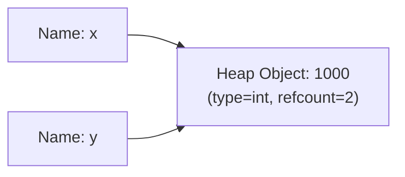

# Module 09: Supplementary Bridges — Object Model, Modules, and Exceptions

> **BCPD Python Cohort 2 Certification Preparation**  
> **Source Screen Mappings:** Previewed across `IMG-02, IMG-11, IMG-22, IMG-45, IMG-56, IMG-67, IMG-76, IMG-79`  
> **Classification:** `[Supplementary]` (Foundational bridge between Week 1 syntax and certification core)

---

## 1. The Python Object-Reference Model `[Supplementary]`

### Variables Are Pointers, Not Buckets
In C or Java, a variable is a typed memory bucket holding a value. In Python, **variables are names (tags) bound to objects living in heap memory**.

```python
x = 1000  # Creates int object 1000 in heap; binds name 'x' to it
y = x     # Binds name 'y' to the SAME int object
```



### Identity vs Equality
- `==`: Compares **values** (calls `__eq__`).
- `is`: Compares **object identities** (memory addresses via `id(x) == id(y)`).

### Caching and Interning Traps
CPython optimizes memory using pre-allocated singletons:
1. **Small Integer Caching:** Integers in the range `[-5, 256]` are pre-allocated at interpreter startup.
   ```python
   a = 250; b = 250
   a is b  # True (same cached object)

   c = 1000; d = 1000
   c is d  # False in REPL, may be folded if compiled in the same code object!
   c == d  # True (always use == for equality!)
   ```
2. **String Interning:** Compile-time string literals resembling identifiers are interned.
3. **Singletons:** `None`, `True`, `False`, and `Ellipsis` (`...`) are unique singletons; always compare using `is` (e.g., `if val is None:`).

---

## 2. Python Module System and Import Mechanics `[Course: IMG-56]`

### The Module Search Path (`sys.path`)
When executing `import my_module`, Python searches locations in this order:
1. The directory containing the input script (or current working directory).
2. `PYTHONPATH` environment variable directories.
3. Standard library directories (e.g. `math`, `os`, `sys`).
4. `site-packages` third-party packages installed via `pip`.

### Import Syntax Variants
```python
import math               # Preferred: qualified namespace (math.sqrt(4))
from math import sqrt     # Imports sqrt directly into current namespace
from math import sqrt as s # Alias
from math import *        # ANTI-PATTERN: Pollutes namespace, risks subtle shadowing
```

### The `__name__ == "__main__"` Idiom
Every Python module has a built-in string variable `__name__`:
- When executed directly from the terminal (`python my_script.py`), Python assigns:
  `__name__ = "__main__"`
- When imported by another file (`import my_script`), Python assigns:
  `__name__ = "my_script"`

```python
def solve():
    return 42

if __name__ == "__main__":
    # Runs ONLY when script is executed directly, not on import!
    print("Result:", solve())
```

### Bytecode and `__pycache__` `[Course: IMG-56]`
As noted in classroom lecture notes (`IMG-56`):
- When a module is imported, Python compiles it to bytecode (`.pyc`) stored in the `__pycache__/` directory.
- Bytecode accelerates import time on subsequent runs by skipping tokenization and parsing if the source file timestamp has not changed.

---

## 3. Exception Handling Fundamentals `[Course: IMG-22, IMG-45, IMG-67, IMG-76]`

Python uses structured exception handling to catch and recover from runtime errors.

### The Full `try / except / else / finally` Suite
```python
try:
    # 1. Code that may raise an exception
    num = int(input("Enter integer: "))
    result = 100 / num
except ValueError as e:
    # 2. Handled if input cannot be converted to int
    print("Invalid format:", e)
except ZeroDivisionError:
    # 3. Handled if user entered 0
    print("Cannot divide by zero!")
else:
    # 4. Executes ONLY if NO exception was raised in try block!
    print("Computation succeeded:", result)
finally:
    # 5. Executes UNCONDITIONALLY (even if return/break/unhandled error occurs)
    print("Cleanup actions completed.")
```

### Standard Exception Hierarchy
All standard exceptions inherit from `BaseException`:
```
BaseException
 ├── SystemExit
 ├── KeyboardInterrupt
 └── Exception (ALL normal program exceptions inherit from here!)
      ├── ArithmeticError
      │    └── ZeroDivisionError
      ├── LookupError
      │    ├── IndexError
      │    └── KeyError
      ├── ValueError
      └── TypeError
```

> [!WARNING]
> ### Bare `except:` Anti-Pattern
> Catching `except:` without an exception class or catching `BaseException` catches system termination signals like `KeyboardInterrupt` (`Ctrl+C`) and `SystemExit`, preventing the user from interrupting runaway scripts.
> **Certification Rule:** Always catch specific exceptions (e.g., `except (ValueError, KeyError):`) or at most `except Exception:`.

---

## 4. Common Exam Traps & Gotchas Summary

1. **`is` vs `==` on Integers / Floats:** Never use `is` to check numerical equality; caching boundaries make it non-deterministic across Python implementations.
2. **`else` Block in Exceptions:** The `else` clause in a `try` statement only runs if the `try` block ran to completion **without** raising an exception.
3. **`finally` Always Runs:** Even if a `try` or `except` block contains an explicit `return` statement, the `finally` block executes before the function exits.
4. **Circular Imports:** Module A importing Module B while Module B imports Module A at the top level causes `ImportError: cannot import name ... from partially initialized module`.
