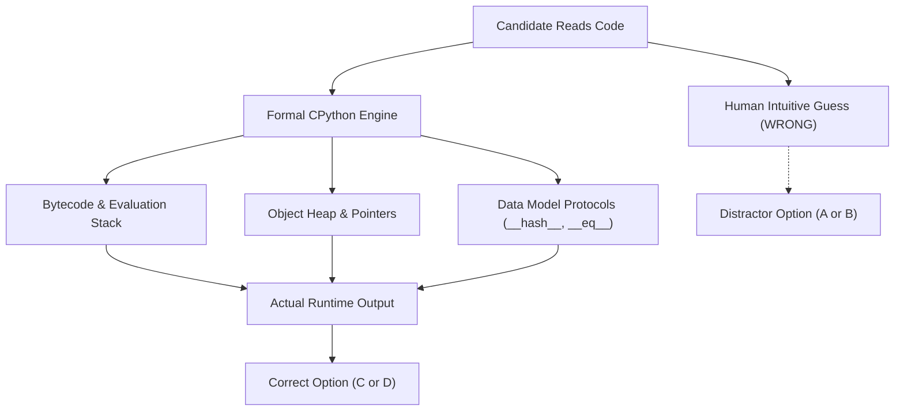

# The BCPD Python Master Exam Traps Encyclopedia
## A Topic-by-Topic Compendium of Pitfalls, Illusions & CPython Quirks

> **BCPD Python Certification — All Syllabus Domains (100% Comprehensive)**  
> **Course Grounding:** Verified across presentation decks (Days 1–9), Sanfoundry drill sets, and Python data model specifications.  
> **Target Audience:** Certification candidates aiming for 90%+ pass marks by neutralizing the questions designed to fail candidates.

---

# Table of Contents
1. [The Anatomy of an Exam Trap (The 10 Cognitive Trap Archetypes)](#1-the-anatomy-of-an-exam-trap)
2. [Domain 1: Environment, Syntax, PEP 8 & Tooling](#domain-1-environment-syntax-pep-8--tooling)
3. [Domain 2: Types, Variables, Identity & Memory Model](#domain-2-types-variables-identity--memory-model)
4. [Domain 3: Operators, Precedence & Bitwise Arithmetic](#domain-3-operators-precedence--bitwise-arithmetic)
5. [Domain 4: Conditionals, Truthiness & Pattern Matching](#domain-4-conditionals-truthiness--pattern-matching)
6. [Domain 5: Loops, Iteration & Complexity](#domain-5-loops-iteration--complexity)
7. [Domain 6: Strings, Formatting & Text Processing](#domain-6-strings-formatting--text-processing)
8. [Domain 7: Lists, Sequences, Sorting & 2D Arrays](#domain-7-lists-sequences-sorting--2d-arrays)
9. [Domain 8: Functions, Parameters, Scope & Recursion](#domain-8-functions-parameters-scope--recursion)
10. [Domain 9: Object Identity, Modules & Exception Lifecycle](#domain-9-object-identity-modules--exception-lifecycle)
11. [Domain 10: Tuples, Records & Collections (Counter & defaultdict)](#domain-10-tuples-records--collections)
12. [Domain 11: Dictionaries, Sets & Hashability](#domain-11-dictionaries-sets--hashability)
13. [Domain 12: Object-Oriented Programming, Encapsulation & Properties](#domain-12-object-oriented-programming--encapsulation)
14. [Domain 13: Inheritance, MRO & Abstract Base Class Traps](#domain-13-inheritance-mro--abstract-base-class-traps)
15. [The 60-Second "Trap Radar" Quick Reference](#the-60-second-trap-radar-quick-reference)

---

# 1. The Anatomy of an Exam Trap

Certification exam writers rarely test simple syntax memorization. Instead, they exploit **cognitive biases**—places where human intuition diverges from CPython's formal execution model:



### The 10 Trap Archetypes:
1. **The Visual Illusion:** Code that *looks* like one thing to human eyes, but compiles as something else (e.g. `(5)` vs `(5,)`, `n = 1,000,000`).
2. **The Silent Killer:** Mutator methods that modify in place and return `None` (e.g. `a = a.sort()`, `s = s.update()`).
3. **The Memory Ghost:** Shared pointers to the same mutable heap object (e.g. `[[0]*3]*3`, `dict.fromkeys("ab", [])`, `def f(x, l=[])`).
4. **The Mathematical Mirage:** Binary floating-point representation and right-associativity (e.g. `-2**4`, `2**3**2`, `round(2.5)`, `0.1+0.2`).
5. **The Truthiness Imposter:** Non-empty objects evaluating to `True` despite their content (e.g. `bool("False")`, `bool([0])`, `all([])`).
6. **The Hash Collision Doppelgänger:** Objects that are distinct types but equal in value and hash (e.g. `{1: 'a', 1.0: 'b', True: 'c'}`).
7. **The Scope & Name-Shadowing Mirage:** Rebinding vs. mutating in enclosing/global scopes (e.g. `UnboundLocalError`, instance masking).
8. **The Asymmetric Operator Trap:** Operators enforcing strict typing where methods accept general iterables (e.g. `set | list` vs `set.union(list)`).
9. **The Pseudosecurity Mirage:** Private attributes being accessible via name mangling (`_ClassName__var`).
10. **The Deferral Overrule:** The `finally` block intercepting or altering returns.

---

# Domain 1: Environment, Syntax, PEP 8 & Tooling

### TRAP 1.1: The Unintentional Tuple via Commas `[Course: IMG-09, IMG-56]`
```python
# THE EXAM BAIT
revenue = 1,000,000
print(type(revenue), len(revenue))
```
- **Intuitive Guess:** `<class 'int'>` (or `SyntaxError` because commas are used as separators).
- **Actual Reality:** `<class 'tuple'> 3`
- **CPython Under the Hood:** In Python, commas—not parentheses—create tuples! Parentheses are only required for grouping or empty tuples. The expression `1, 000, 000` evaluates as three integers `(1, 0, 0)` packed into a 3-element tuple.
- **Exam Writer's Angle:** Candidates coming from math/finance instinctively read commas as thousands separators.
- **Antidote:** Use PEP 515 underscores for digit grouping: `revenue = 1_000_000`.

---

### TRAP 1.2: The `input()` String Concatenation Trap `[Course: IMG-05, IMG-11, IMG-22]`
```python
# THE EXAM BAIT
x = input("Enter number: ")  # User types 5
y = input("Enter number: ")  # User types 10
print(x + y)
```
- **Intuitive Guess:** `15`
- **Actual Reality:** `'510'`
- **CPython Under the Hood:** The built-in `input()` function **always** returns a string (`str`), regardless of whether the user typed digits. The `+` operator on two strings performs string concatenation, producing `'510'`.
- **Exam Writer's Angle:** Tests whether the candidate remembers that Python is dynamically typed but **strongly typed** (it does not perform implicit string-to-int coercion like JavaScript).
- **Antidote:** Explicitly cast upon intake: `x = int(input())`.

---

### TRAP 1.3: Mixing Tabs and Spaces (`TabError`) `[Course: IMG-19, IMG-56]`
```python
# THE EXAM BAIT
def verify():
    x = 10     # Indented with 4 spaces
	return x   # Indented with 1 Tab character (ASCII 9)
```
- **Intuitive Guess:** Code executes normally because visually both lines look aligned.
- **Actual Reality:** `TabError: inconsistent use of tabs and spaces in indentation`
- **CPython Under the Hood:** Python 3 strictly prohibits mixing tabs and spaces for indentation within the same block. CPython raises `TabError` (a subclass of `IndentationError`) during the lexing phase before running a single bytecode instruction.
- **Antidote:** Follow PEP 8 strictly: configure IDEs to expand Tab key presses into exactly 4 spaces.

---

# Domain 2: Types, Variables, Identity & Memory Model

### TRAP 2.1: Banker's Rounding (Round Half to Even) `[Course: IMG-10, IMG-30]`
```python
# THE EXAM BAIT
print(round(2.5), round(3.5), round(4.5))
```
- **Intuitive Guess:** `3 4 5` (Standard school rounding: .5 rounds up).
- **Actual Reality:** `2 4 4`
- **CPython Under the Hood:** Python 3 implements IEEE 754 Banker's Rounding ("round half to even"). When a float is equidistant from two integers, it rounds to the **nearest even integer**. `2.5` rounds down to `2`, `3.5` rounds up to `4`, and `4.5` rounds down to `4`.
- **Exam Writer's Angle:** Directly tests knowledge of Python 3's deviation from Python 2 and traditional elementary school rounding.
- **Antidote:** For commercial/financial rounding (half up), use the `decimal` module with `ROUND_HALF_UP`.

---

### TRAP 2.2: Floating-Point IEEE 754 Imprecision `[Course: IMG-09, IMG-11, IMG-31]`
```python
# THE EXAM BAIT
print(0.1 + 0.2 == 0.3)
print(0.1 + 0.1 + 0.1 == 0.3)
```
- **Intuitive Guess:** `True True`
- **Actual Reality:** `False False`
- **CPython Under the Hood:** Binary hardware cannot represent base-10 fractions like `1/10` or `1/5` with finite binary bits. `0.1` is stored internally as `0.0001100110011..._2` (approx `0.10000000000000000555...`). Consequently, `0.1 + 0.2` evaluates to `0.30000000000000004`, which is not equal to `0.3`.
- **Antidote:** Never use `==` for float equality; use `math.isclose(a, b)` or `decimal.Decimal`.

---

### TRAP 2.3: Small Integer Caching & Identity (`==` vs `is`) `[Course: IMG-15, IMG-32]`
```python
# THE EXAM BAIT
a = 256; b = 256
c = 257; d = 257
print(a is b, c is d)
```
- **Intuitive Guess:** `True True` (or `False False` because they are separate variable assignments).
- **Actual Reality:** `True False` (in interactive REPL / separate execution frames)
- **CPython Under the Hood:** CPython pre-allocates an array of singleton integer objects for the range `[-5, 256]`. Any variable assigned an integer in this range references the exact same singleton object in memory (`a is b`). Outside this range, CPython may allocate distinct objects (`c is not d`).
- **Antidote:** Use `is` **only** for testing identity against singletons (`None`, `True`, `False`). For values, always use `==`.

---

# Domain 3: Operators, Precedence & Bitwise Arithmetic

### TRAP 3.1: Unary Minus vs. Exponentiation Precedence `[Course: IMG-08, IMG-10, IMG-30]`
```python
# THE EXAM BAIT
print(-2 ** 4)
print((-2) ** 4)
```
- **Intuitive Guess:** `16 16`
- **Actual Reality:** `-16 16`
- **CPython Under the Hood:** In Python's operator precedence table, exponentiation (`**`) binds **tighter** than the unary minus (`-`). Python parses `-2 ** 4` as `-(2 ** 4) = -(16) = -16`.
- **Exam Writer's Angle:** One of the top 3 most frequently missed questions on entry-level certification exams worldwide.
- **Antidote:** Parenthesize negative bases explicitly: `(-2) ** 4`.

---

### TRAP 3.2: Right-Associativity of Exponentiation `[Course: IMG-08, IMG-10, IMG-30]`
```python
# THE EXAM BAIT
print(2 ** 3 ** 2)
```
- **Intuitive Guess:** `64` (`(2 ** 3) ** 2 = 8 ** 2 = 64`)
- **Actual Reality:** `512`
- **CPython Under the Hood:** Exponentiation is **right-associative** (evaluates right-to-left), unlike multiplication or division which are left-associative. Python evaluates `3 ** 2 = 9` first, and then `2 ** 9 = 512`.
- **Antidote:** Add explicit parentheses to clarify intent: `(2 ** 3) ** 2` vs `2 ** (3 ** 2)`.

---

### TRAP 3.3: Two's Complement Bitwise Inversion `[Course: IMG-13, IMG-14, IMG-16]`
```python
# THE EXAM BAIT
print(~10, ~(-10), ~0)
```
- **Intuitive Guess:** `-10 10 1` (or bitwise flipped binary bits)
- **Actual Reality:** `-11 9 -1`
- **CPython Under the Hood:** Python integers use arbitrary-precision two's complement representation. The bitwise NOT operator `~x` mathematically satisfies the exact identity:
  $$\sim x = -x - 1$$
  - $\sim 10 = -10 - 1 = -11$
  - $\sim (-10) = -(-10) - 1 = 10 - 1 = 9$
  - $\sim 0 = -0 - 1 = -1$
- **Antidote:** Memorize the formula `~x = -x - 1`.

---

### TRAP 3.4: Negative Floor Division & Modulo `[Course: IMG-07, IMG-08, IMG-30]`
```python
# THE EXAM BAIT
print(-17 // 5, -17 % 5)
```
- **Intuitive Guess:** `-3 -2`
- **Actual Reality:** `-4 3`
- **CPython Under the Hood:**
  1. Floor division `//` always rounds toward **negative infinity**. `-17 / 5 = -3.4`, which floors down to `-4`.
  2. Modulo `%` in Python always matches the **sign of the divisor** ($5$ is positive, so remainder must be $\ge 0$).
  3. Formula: $r = a - (a // b) \times b = -17 - (-4 \times 5) = -17 - (-20) = 3$.
- **Antidote:** Remember that in Python, `a == (a // b) * b + (a % b)` is an invariant that holds for all integers.

---

# Domain 4: Conditionals, Truthiness & Pattern Matching

### TRAP 4.1: Short-Circuit Operand Return Value `[Course: IMG-32, IMG-37, IMG-40, IMG-47]`
```python
# THE EXAM BAIT
x = 0 or [] or "python"
y = "hello" and 42 and [1, 2]
print(x, y)
```
- **Intuitive Guess:** `True True`
- **Actual Reality:** `'python' [1, 2]`
- **CPython Under the Hood:** In Python, `or` and `and` **do not return booleans**; they return the operand that decided the truth value!
  - `or` returns the **first truthy operand** it encounters (or the last operand if all are falsy). `0` is falsy, `[]` is falsy, so it returns `"python"`.
  - `and` returns the **first falsy operand** it encounters, or the **last operand** if all are truthy. Both `"hello"` and `42` are truthy, so it returns `[1, 2]`.
- **Antidote:** Use `bool(x or y)` if you need a strict `True`/`False` boolean.

---

### TRAP 4.2: Truthiness of Non-Empty Containers & Strings `[Course: IMG-12, IMG-30, IMG-32]`
```python
# THE EXAM BAIT
print(bool("False"), bool("0"), bool(" "), bool([0]), bool((None,)))
```
- **Intuitive Guess:** `False False False False False`
- **Actual Reality:** `True True True True True`
- **CPython Under the Hood:** In Python, string truthiness is determined strictly by **length** (`len(s) > 0`). It does not inspect the semantic text inside the string. `"False"`, `"0"`, and `" "` have length $> 0$, so they are `True`. Similarly, `[0]` has length 1 (holding integer 0), and `(None,)` has length 1, so both collections are truthy!
- **Antidote:** Compare explicitly: `if text == "True":`.

---

### TRAP 4.3: Chained Comparison Precedence `[Course: IMG-36, IMG-44]`
```python
# THE EXAM BAIT
print(False == False in [False])
```
- **Intuitive Guess:** `True` (`(False == False) is True, and True in [False] is False? Or True in [False] evaluated first?`)
- **Actual Reality:** `True`
- **CPython Under the Hood:** In Python, all comparison operators (including `==`, `<`, `>`, `in`, `is`) have equal precedence and **chain**!
  The expression `False == False in [False]` compiles to:
  $$(False == False) \text{ and } (False \text{ in } [False])$$
  1. `False == False` is `True`.
  2. `False in [False]` is `True`.
  3. `True and True` evaluates to `True`!
- **Antidote:** Always parenthesize compound comparisons when mixing equality and membership.

---

# Domain 5: Loops, Iteration & Complexity

### TRAP 5.1: The Loop `else` Clause with `break` `[Course: IMG-43, IMG-50]`
```python
# THE EXAM BAIT
for i in range(3):
    if i == 1:
        break
else:
    print("Loop finished!")
```
- **Intuitive Guess:** Prints `"Loop finished!"` (students think `else` runs when the `if` condition is false).
- **Actual Reality:** Prints *nothing*.
- **CPython Under the Hood:** In a `for` or `while` loop, the `else` block executes **only if the loop completes without encountering a `break`**. When `i == 1`, `break` terminates the loop immediately, skipping the `else` block entirely.
- **Antidote:** Read loop `else` as *"if no break occurred"*.

---

### TRAP 5.2: Modifying a Sequence While Iterating Over It `[Course: IMG-46, IMG-70]`
```python
# THE EXAM BAIT
nums = [1, 2, 4, 5]
for n in nums:
    if n % 2 == 0:
        nums.remove(n)
print(nums)
```
- **Intuitive Guess:** `[1, 5]` (all even numbers removed).
- **Actual Reality:** `[1, 4, 5]` (Wait, why is `4` still in the list?!)
- **CPython Under the Hood:** Python tracks iteration using an internal integer index ($0, 1, 2, \dots$):
  - At index 0: visits `1` (odd).
  - At index 1: visits `2` (even). Removes `2`.
  - When `2` is removed, the remaining items `[4, 5]` shift left! `4` moves to index 1, and `5` moves to index 2.
  - The loop now advances to index 2, which is now `5`!
  - Element `4` (which was shifted to index 1) was completely skipped!
- **Antidote:** Always iterate over a copy: `for n in nums[:]:` or use a list comprehension: `nums = [n for n in nums if n % 2 != 0]`.

---

### TRAP 5.3: Generator Expression One-Shot Exhaustion `[Course: IMG-54, IMG-55, IMG-78]`
```python
# THE EXAM BAIT
gen = (x * x for x in range(3))
print(sum(gen), sum(gen))
```
- **Intuitive Guess:** `5 5` (`0 + 1 + 4 = 5`)
- **Actual Reality:** `5 0`
- **CPython Under the Hood:** A generator expression produces a lazy iterator. The first `sum(gen)` pulls items via `__next__()` until `StopIteration` is raised. The generator is now completely exhausted. The second `sum(gen)` immediately receives `StopIteration` and returns default `0`.
- **Antidote:** If multiple iterations are needed, store in a list: `data = list(...)`.

---

# Domain 6: Strings, Formatting & Text Processing

### TRAP 6.1: String Immutability Ignored `[Course: IMG-57, IMG-58, IMG-59/64]`
```python
# THE EXAM BAIT
s = "python"
s.upper()
s.replace("p", "j")
print(s)
```
- **Intuitive Guess:** `'jython'` or `'PYTHON'`
- **Actual Reality:** `'python'`
- **CPython Under the Hood:** Strings in Python are strictly immutable. Calling `.upper()` or `.replace()` calculates a brand new string in heap memory and returns its pointer. If the caller does not rebind the variable (`s = s.upper()`), the returned object is immediately garbage collected, and `s` remains unchanged.
- **Antidote:** Reassign: `s = s.replace("p", "j").upper()`.

---

### TRAP 6.2: Slicing Out-of-Bounds vs Indexing Out-of-Bounds `[Course: IMG-57, IMG-58]`
```python
# THE EXAM BAIT
s = "abc"
print(s[10:20])
print(s[10])
```
- **Intuitive Guess:** Both raise `IndexError`.
- **Actual Reality:** First line prints `""` (empty string); second line raises `IndexError: string index out of range`.
- **CPython Under the Hood:**
  - Direct index `s[i]` demands a specific offset and raises `IndexError` if $i \ge \text{len}(s)$.
  - Slicing `s[start:stop]` clamps bounds gracefully to `[0, len(s)]`. If `start >= len(s)`, it returns an empty sequence.
- **Antidote:** Use slicing when you want to avoid `IndexError` on missing sub-sequences.

---

### TRAP 6.3: `str.join()` on Non-String Elements `[Course: IMG-62/65, IMG-70, D6-05]`
```python
# THE EXAM BAIT
numbers = [1, 2, 3]
print("-".join(numbers))
```
- **Intuitive Guess:** `'1-2-3'`
- **Actual Reality:** `TypeError: sequence item 0: expected str instance, int found`
- **CPython Under the Hood:** `str.join()` expects an iterable where **every element is already of type `str`**. It does not perform implicit type casting on integers or floats.
- **Antidote:** Map to strings first: `"-".join(map(str, numbers))` or `"-".join(str(n) for n in numbers)`.

---

### TRAP 6.4: Escaping Literal Braces in f-strings & `str.format()` `[Course: IMG-01, IMG-69, D5-REV-09]`
```python
# THE EXAM BAIT
print("{{literal}}".format())
print(f"{{{42}}}")
```
- **Intuitive Guess:** `{{literal}}` and `{42}`
- **Actual Reality:** `{literal}` and `{42}`
- **CPython Under the Hood:** In Python string formatting, doubling a brace (`{{` or `}}`) is the escape sequence to produce a single literal brace `{` or `}`. In `f"{{{42}}}"`, the outer double braces become literal `{` and `}`, while the inner `{42}` evaluates expression `42`.
- **Antidote:** Count brace pairs carefully: `{{` -> `{`, `{expr}` -> value, `}}` -> `}`.

---

# Domain 7: Lists, Sequences, Sorting & 2D Arrays

### TRAP 7.1: Overwriting List with In-Place Sort `[Course: IMG-61, IMG-71, D5-REV-01]`
```python
# THE EXAM BAIT
items = [3, 1, 2]
items = items.sort()
print(items)
```
- **Intuitive Guess:** `[1, 2, 3]`
- **Actual Reality:** `None`
- **CPython Under the Hood:** Methods that modify a list in place (`sort()`, `append()`, `reverse()`, `extend()`, `insert()`, `clear()`) intentionally return `None` (a deliberate Python design choice to prevent confusion with non-mutating methods). Reassigning `items = items.sort()` overwrites the list with `None`, permanently discarding your data!
- **Antidote:** Call `items.sort()` without assignment, or use `items = sorted(items)`.

---

### TRAP 7.2: The 2D Array Pointer Duplication Trap `[Course: IMG-03, IMG-70, IMG-74, D5-REV-08]`
```python
# THE EXAM BAIT
grid = [[0] * 3] * 3
grid[0][0] = 1
print(grid)
```
- **Intuitive Guess:** `[[1, 0, 0], [0, 0, 0], [0, 0, 0]]`
- **Actual Reality:** `[[1, 0, 0], [1, 0, 0], [1, 0, 0]]` (All 3 rows changed!)
- **CPython Under the Hood:** The multiplication operator `[row] * 3` does not clone the inner list; it copies the **pointer** to that same list 3 times!
  All three row indices `grid[0]`, `grid[1]`, and `grid[2]` point to the **exact same list in heap memory**:
  ```
  grid ----> [ Pointer0, Pointer1, Pointer2 ]
                  │          │         │
                  └──────────┼─────────┘
                             ▼
                        [ 1, 0, 0 ]
  ```
- **Antidote:** Always use a list comprehension to allocate distinct inner rows:
  `grid = [[0] * 3 for _ in range(3)]`.

---

### TRAP 7.3: ASCII Case-Sensitive Sorting `[Course: D6-02, D6-11]`
```python
# THE EXAM BAIT
fruits = ["apple", "Pear", "banana"]
print(sorted(fruits))
```
- **Intuitive Guess:** `['apple', 'banana', 'Pear']`
- **Actual Reality:** `['Pear', 'apple', 'banana']`
- **CPython Under the Hood:** Python sorts strings by Unicode / ASCII numerical code points (`ord()`). Uppercase letters (`'A'`–`'Z'`: 65–90) precede lowercase letters (`'a'`–`'z'`: 97–122). Because `'P'` is 80 and `'a'` is 97, `"Pear"` sorts before `"apple"`.
- **Antidote:** For case-insensitive sorting, pass the lowercase key: `sorted(fruits, key=str.lower)`.

---

# Domain 8: Functions, Parameters, Scope & Recursion

### TRAP 8.1: The Mutable Default Argument Trap `[Course: IMG-75, D5-02]`
```python
# THE EXAM BAIT
def append_to(val, target=[]):
    target.append(val)
    return target

print(append_to(1))
print(append_to(2))
print(append_to(3))
```
- **Intuitive Guess:** `[1]`, then `[2]`, then `[3]`
- **Actual Reality:** `[1]`, then `[1, 2]`, then `[1, 2, 3]`
- **CPython Under the Hood:** In Python, default parameter expressions are evaluated **once at function definition time**, NOT at each call! The single empty list `[]` is created when the `def` statement compiles and is bound to the function's `__defaults__` tuple. Every call that omits `target` shares that exact same list!
- **Antidote:** Use `None` as a sentinel default:
  ```python
  def append_to(val, target=None):
      if target is None:
          target = []
      target.append(val)
      return target
  ```

---

### TRAP 8.2: `UnboundLocalError` (The Scope Shadowing Illusion) `[Course: D5-04]`
```python
# THE EXAM BAIT
x = 10
def modify():
    print(x)
    x = 20

modify()
```
- **Intuitive Guess:** Prints `10`, then sets local `x` to `20`.
- **Actual Reality:** `UnboundLocalError: cannot access local variable 'x' where it is not associated with a value`
- **CPython Under the Hood:** Python inspects functions at **compile time**. If an assignment to `x` (`x = 20`) appears anywhere inside the function body, Python marks `x` as a **local variable for the entire function**.
  When line 1 tries to read `print(x)`, Python searches only the local frame. Because local `x` hasn't been assigned yet, it raises `UnboundLocalError`. It will NOT fall back to global `x`!
- **Antidote:** If intending to modify the global variable, declare `global x` at the top of the function.

---

### TRAP 8.3: Late-Binding Closures in Loops `[Course: D6-07]`
```python
# THE EXAM BAIT
funcs = [lambda: i for i in range(3)]
print([f() for f in funcs])
```
- **Intuitive Guess:** `[0, 1, 2]`
- **Actual Reality:** `[2, 2, 2]`
- **CPython Under the Hood:** Python closures look up variables by name in their enclosing scope at **execution time**, not definition time. By the time the lambdas are called, the loop has completed and `i` is `2`. All three lambdas look up `i` and see `2`!
- **Antidote:** Bind `i` as a default parameter at definition time: `[lambda i=i: i for i in range(3)]`.

---

# Domain 9: Object Identity, Modules & Exception Lifecycle

### TRAP 9.1: The `finally` Return Override `[Course: IMG-45, IMG-67]`
```python
# THE EXAM BAIT
def get_val():
    try:
        return 1
    finally:
        return 2

print(get_val())
```
- **Intuitive Guess:** `1` (because `return 1` happened first).
- **Actual Reality:** `2`
- **CPython Under the Hood:** The `finally` block is guaranteed to execute before the function exits. If a `finally` block executes a `return` or `raise` statement, that return/raise **discards** any pending return value or exception from the `try` or `except` blocks!
- **Antidote:** Never write `return` or `raise` inside a `finally` block; use `finally` strictly for resource cleanup.

---

### TRAP 9.2: Small-Int Caching vs Tuple/List Mutation `[Course: IMG-79]`
```python
# THE EXAM BAIT
a = ([1], 2)
try:
    a[0] += [3]
except TypeError:
    pass
print(a)
```
- **Intuitive Guess:** `([1], 2)` (TypeError occurred, so mutation rolled back).
- **Actual Reality:** `([1, 3], 2)` (It mutated AND raised an error!)
- **CPython Under the Hood:** The augmented assignment `a[0] += [3]` performs two distinct bytecode steps:
  1. `list.__iadd__()` executes in-place: `[1]` becomes `[1, 3]`.
  2. Bytecode attempts to store the result back into `a[0]`: `STORE_SUBSCR`.
  3. Because `a` is a tuple, `STORE_SUBSCR` raises `TypeError: 'tuple' object does not support item assignment`!
  4. The in-place mutation already succeeded before the exception was raised!
- **Exam Writer's Angle:** An legendary Python trap that exposes candidate understanding of bytecode evaluation order.
- **Antidote:** Never perform augmented assignments (`+=`) on mutable objects nested inside tuples.

---

# Domain 10: Tuples, Records & Collections

### TRAP 10.1: The Single-Element Tuple Comma Omission `[Course: D8-03]`
```python
# THE EXAM BAIT
a = (42)
b = (42,)
print(type(a), type(b))
```
- **Intuitive Guess:** `<class 'tuple'> <class 'tuple'>`
- **Actual Reality:** `<class 'int'> <class 'tuple'>`
- **CPython Under the Hood:** Parentheses without a comma simply perform mathematical grouping. `(42)` is integer `42`. To create a 1-element tuple, a trailing comma is syntactically mandatory: `(42,)` or `42,`.
- **Antidote:** Always include the trailing comma for single-item tuples.

---

### TRAP 10.2: Unpacking Count Mismatch (`ValueError`) `[Course: D8-04]`
```python
# THE EXAM BAIT
point = (1, 2, 3)
x, y = point
```
- **Intuitive Guess:** `x = 1, y = 2` (or trailing elements ignored).
- **Actual Reality:** `ValueError: too many values to unpack (expected 2, got 3)`
- **CPython Under the Hood:** Sequence unpacking requires an exact 1-to-1 match between variables on the left and elements in the sequence on the right.
- **Antidote:** Use star unpacking (`*`) to capture extra items: `x, y, *rest = point`.

---

### TRAP 10.3: `namedtuple` Immutability `[Course: D8-04]`
```python
# THE EXAM BAIT
from collections import namedtuple
Point = namedtuple("Point", ["x", "y"])
p = Point(1, 2)
p.x = 10
```
- **Intuitive Guess:** `p.x` becomes `10` (looks like an object attribute assignment).
- **Actual Reality:** `AttributeError: can't set attribute`
- **CPython Under the Hood:** `namedtuple` subclasses `tuple`. Like standard tuples, `namedtuple` instances are strictly immutable. Their fields cannot be reassigned.
- **Antidote:** Use `p._replace(x=10)` to return a *new* `namedtuple` with the updated field.

---

# Domain 11: Dictionaries, Sets & Hashability

### TRAP 11.1: `dict.fromkeys()` Shared Mutable Reference `[Course: D8-05]`
```python
# THE EXAM BAIT
d = dict.fromkeys(["a", "b"], [])
d["a"].append(100)
print(d)
```
- **Intuitive Guess:** `{'a': [100], 'b': []}`
- **Actual Reality:** `{'a': [100], 'b': [100]}`
- **CPython Under the Hood:** `dict.fromkeys(keys, value)` passes the **exact same object reference** `value` to each key. When `value` is mutable (`[]`), both keys `'a'` and `'b'` point to the single list in heap memory.
- **Antidote:** Use a dict comprehension: `d = {k: [] for k in ["a", "b"]}`.

---

### TRAP 11.2: Numeric Key Hash & Value Equality Collision `[Course: D8-07]`
```python
# THE EXAM BAIT
d = {1: "one", 1.0: "float_one", True: "bool_one"}
print(len(d), d)
```
- **Intuitive Guess:** `3 {1: 'one', 1.0: 'float_one', True: 'bool_one'}`
- **Actual Reality:** `1 {1: 'bool_one'}`
- **CPython Under the Hood:**
  - Python dictionaries determine key uniqueness by testing both `hash(k1) == hash(k2)` and `k1 == k2`.
  - In Python:
    $$1 == 1.0 == \text{True}$$
    $$\text{hash}(1) == \text{hash}(1.0) == \text{hash}(\text{True}) == 1$$
  - All three keys are mathematically identical in value and hash!
  - When `1.0` is inserted, it finds key `1` already present, so it overwrites the value while preserving the existing key object (`1`).
  - When `True` is inserted, it again overwrites the value.
  - Final dictionary has length 1: `{1: 'bool_one'}`!
- **Antidote:** Convert keys to strings (`{"1": ..., "1.0": ...}`) if type distinctions must be preserved.

---

### TRAP 11.3: Set Bitwise Operators vs. Set Methods `[Course: D8-14]`
```python
# THE EXAM BAIT
s = {1, 2}
print(s.union([3, 4]))
print(s | [3, 4])
```
- **Intuitive Guess:** Both print `{1, 2, 3, 4}`.
- **Actual Reality:** First line prints `{1, 2, 3, 4}`; second line raises `TypeError: unsupported operand type(s) for |: 'set' and 'list'`.
- **CPython Under the Hood:**
  - Set **methods** (`union`, `intersection`, `difference`) accept *any iterable* as arguments.
  - Set **operators** (`|`, `&`, `-`, `^`) strictly require *both operands to be sets or frozensets*.
- **Antidote:** Use `.union()` when combining with non-set iterables, or cast explicitly: `s | set([3, 4])`.

---

### TRAP 11.4: Sets Do NOT Support `+` or `*` `[Course: D8-14]`
```python
# THE EXAM BAIT
s1 = {1, 2}
s2 = {3, 4}
s3 = s1 + s2
```
- **Intuitive Guess:** `s3 = {1, 2, 3, 4}` (like lists and strings).
- **Actual Reality:** `TypeError: unsupported operand type(s) for +: 'set' and 'set'`
- **CPython Under the Hood:** Sets do not define `__add__` or `__mul__`. Sequence concatenation implies order and duplicates, neither of which exists in sets.
- **Antidote:** Use union: `s1 | s2` or `s1.union(s2)`.

---

### TRAP 11.5: Truthiness of Empty Sets (`all` vs `any`) `[Course: D8-14]`
```python
# THE EXAM BAIT
print(all(set()), any(set()))
```
- **Intuitive Guess:** `False False` (empty set has nothing truthy).
- **Actual Reality:** `True False`
- **CPython Under the Hood:**
  - `all(iterable)` returns `True` if no element in the iterable is false. Because an empty set contains no elements, no false elements exist—this is **vacuous truth**!
  - `any(iterable)` returns `True` if at least one element is true. Since the set is empty, it returns `False`.
- **Antidote:** Check `bool(s) and all(s)` if you need the set to be non-empty.

---

# Domain 12: Object-Oriented Programming & Encapsulation

### TRAP 12.1: The Shared Mutable Class Attribute `[Course: D9-08]`
```python
# THE EXAM BAIT
class Dog:
    tricks = []
    def __init__(self, name):
        self.name = name

d1 = Dog("Fido")
d2 = Dog("Rex")
d1.tricks.append("fetch")
print(d2.tricks)
```
- **Intuitive Guess:** `[]` (Rex hasn't learned any tricks).
- **Actual Reality:** `['fetch']`
- **CPython Under the Hood:** Any variable defined directly in the class body belongs to the **class namespace**, NOT the instance. `Dog.tricks` is a single list shared by all instances. Calling `d1.tricks.append()` mutates this single shared list!
- **Antidote:** Initialize mutable instance attributes inside `__init__`:
  ```python
  def __init__(self, name):
      self.name = name
      self.tricks = []
  ```

---

### TRAP 12.2: Instance Attribute Assignment Masks Class Attribute `[Course: D9-08]`
```python
# THE EXAM BAIT
class Dog:
    species = "Canis familiaris"

d1 = Dog()
d2 = Dog()
d1.species = "Wolf"
print(d1.species, d2.species, Dog.species)
```
- **Intuitive Guess:** `'Wolf' 'Wolf' 'Wolf'` (or `'Wolf' 'Canis' 'Wolf'`).
- **Actual Reality:** `'Wolf' 'Canis familiaris' 'Canis familiaris'`
- **CPython Under the Hood:**
  - When accessing `obj.attr`, Python checks the instance dictionary `obj.__dict__` first. If missing, it checks the class dictionary `Dog.__dict__`.
  - When assigning `d1.species = "Wolf"`, Python creates a brand-new key in `d1.__dict__`. It **never writes to the class**.
  - `d2` has no `species` in `d2.__dict__`, so it falls back to `Dog.species` (`'Canis familiaris'`).
- **Antidote:** If intended to modify the class attribute, assign to the class directly: `Dog.species = "Wolf"`.

---

### TRAP 12.3: Forgetting `self` in Method Definitions `[Course: D9-09]`
```python
# THE EXAM BAIT
class Calculator:
    def add(x, y):
        return x + y

c = Calculator()
print(c.add(2, 3))
```
- **Intuitive Guess:** `5`
- **Actual Reality:** `TypeError: Calculator.add() takes 2 positional arguments but 3 were given`
- **CPython Under the Hood:** Calling `c.add(2, 3)` automatically passes instance `c` as the first argument:
  `Calculator.add(c, 2, 3)`.
  Because `add` only defined two parameters `x` and `y`, Python sees 3 arguments and raises `TypeError`.
- **Antidote:** Always include `self`: `def add(self, x, y):`, or use `@staticmethod` if no instance state is needed.

---

### TRAP 12.4: Private Attribute Name Mangling `[Course: D9-06, D9-11]`
```python
# THE EXAM BAIT
class BankAccount:
    def __init__(self, balance):
        self.__balance = balance

acc = BankAccount(100)
print(acc.__balance)
```
- **Intuitive Guess:** `100` (or compilation error).
- **Actual Reality:** `AttributeError: 'BankAccount' object has no attribute '__balance'`
- **CPython Under the Hood:** Any identifier with two leading underscores (`__var`) undergoes **name mangling**. The Python compiler renames it to `_ClassName__var` (`_BankAccount__balance`) to avoid accidental overrides in subclasses.
  Accessing `acc.__balance` fails, but accessing `acc._BankAccount__balance` succeeds!
- **Antidote:** Name mangling is NOT security. Use `@property` for public getters and setters.

---

### TRAP 12.5: Assigning to a Read-Only Property `[Course: D9-10]`
```python
# THE EXAM BAIT
class Circle:
    def __init__(self, radius):
        self._radius = radius

    @property
    def radius(self):
        return self._radius

c = Circle(5)
c.radius = 10
```
- **Intuitive Guess:** `c.radius` updates to `10`.
- **Actual Reality:** `AttributeError: property 'radius' of 'Circle' object has no setter` (or `can't set attribute`)
- **CPython Under the Hood:** `@property` defines a getter. If no `@<name>.setter` decorator is provided, Python marks the attribute descriptor as read-only. Attempting to assign to it raises `AttributeError`.
- **Antidote:** Define a setter decorator:
  ```python
  @radius.setter
  def radius(self, val):
      self._radius = val
  ```

---

# Domain 13: Inheritance, MRO & Abstract Base Class Traps

### Trap 13.1 (Trap 37): Omitting `super().__init__()` Leaves Parent Attributes Uninitialized `[Course: D10-05]`
- **The Code:**
  ```python
  class Base:
      def __init__(self, name):
          self.name = name

  class Child(Base):
      def __init__(self, name, age):
          # Forgot super().__init__(name)!
          self.age = age

  c = Child("Ada", 25)
  print(c.name)
  ```
- **Intuitive Guess:** Python automatically calls `Base.__init__`, printing `"Ada"`.
- **Actual Reality:** `AttributeError: 'Child' object has no attribute 'name'`
- **CPython Under the Hood:** Unlike Java or C++, CPython does **not** automatically chain constructor calls in derived classes. If the child overrides `__init__`, the parent's `__init__` will only execute if called explicitly via `super().__init__(...)`.
- **Antidote:** Always invoke `super().__init__(*args, **kwargs)` at the start of child initializers.

---

### Trap 13.2 (Trap 38): The Diamond Problem & C3 Linearization Order `[Course: D10-04, D10-06]`
- **The Code:**
  ```python
  class A:
      def who(self): return "A"
  class B(A):
      def who(self): return "B"
  class C(A):
      def who(self): return "C"
  class D(B, C):
      pass

  print(D().who())
  ```
- **Intuitive Guess:** Ambiguous method call error, or `"A"` because `A` is the common grandparent.
- **Actual Reality:** Prints `"B"`.
- **CPython Under the Hood:** Python calculates the Method Resolution Order using C3 Linearization. For `class D(B, C)`, the search order is `D -> B -> C -> A -> object`. Since `B` is declared first in `(B, C)`, `B.who()` is resolved first.
- **Antidote:** Inspect the exact MRO via `Class.mro()` or `Class.__mro__`.

---

### Trap 13.3 (Trap 39): `isinstance(True, int)` is True vs. `type(True) is int` is False `[Course: D10-07]`
- **The Code:**
  ```python
  print(isinstance(True, int))
  print(type(True) is int)
  ```
- **Intuitive Guess:** `False` and `False` because booleans and integers are different data types.
- **Actual Reality:**
  ```python
  True
  False
  ```
- **CPython Under the Hood:** In Python, `bool` is an explicit subclass of `int` (`issubclass(bool, int) is True`). `isinstance()` checks if an object is an instance of a class **or any of its subclasses**. However, `type(x) is T` checks exact object type identity without walking the inheritance chain.
- **Antidote:** Use `isinstance()` for polymorphic compatibility, but `type(x) is int` if you must strictly exclude `bool` instances.

---

### Trap 13.4 (Trap 40): Instantiating an Incomplete Abstract Base Class `[Course: D10-02, Manual §11.6]`
- **The Code:**
  ```python
  from abc import ABC, abstractmethod

  class Service(ABC):
      @abstractmethod
      def execute(self): pass

  class ConcreteService(Service):
      pass

  s = ConcreteService()
  ```
- **Intuitive Guess:** Instantiation succeeds; calling `s.execute()` returns `None`.
- **Actual Reality:** `TypeError: Can't instantiate abstract class ConcreteService without an implementation for abstract method 'execute'`
- **CPython Under the Hood:** Python's `ABCMeta` intercepts instantiation at `__call__` time. If any method in `__abstractmethods__` has not been overridden by a concrete implementation, instantiation is blocked immediately with a `TypeError`.
- **Antidote:** Ensure every `@abstractmethod` is fully implemented in the child class before instantiating.

---

### Trap 13.5 (Trap 41): Private Attribute Isolation Across Inheritance `[Course: D10-05]`
- **The Code:**
  ```python
  class Parent:
      def __init__(self):
          self.__token = "parent_token"

  class Child(Parent):
      def __init__(self):
          super().__init__()
          self.__token = "child_token"

  c = Child()
  print(c._Parent__token, c._Child__token)
  ```
- **Intuitive Guess:** The child's `__token` overwrites the parent's `__token`, raising an error or printing `"child_token child_token"`.
- **Actual Reality:** Prints `"parent_token child_token"`.
- **CPython Under the Hood:** Private name mangling prefixes double-underscore attributes with `_<ClassName>`. Inside `Parent`, `self.__token` compiles to `self._Parent__token`. Inside `Child`, `self.__token` compiles to `self._Child__token`. They reside as completely independent entries in `c.__dict__`.
- **Antidote:** If an attribute is intended to be overridden or accessed by subclasses, use a single underscore `_token` (protected by convention), not double underscores.

---

### Trap 13.6 (Trap 42): Mutable Default Field in Dataclass `[Course: D10-02, Manual §11.9]`
- **The Code:**
  ```python
  from dataclasses import dataclass

  @dataclass
  class Team:
      members: list = []
  ```
- **Intuitive Guess:** Creates a class where each `Team` instance starts with an empty list.
- **Actual Reality:** `ValueError: mutable default <class 'list'> for field members is not allowed: use default_factory`
- **CPython Under the Hood:** Standard Python functions allow `def f(x=[])`, creating the notorious shared mutable default trap. To prevent this architectural flaw, `@dataclass` aggressively inspects field defaults at class-creation time and raises `ValueError` if a mutable container (`list`, `dict`, `set`) is assigned directly.
- **Antidote:** Use `field(default_factory=list)`:
  ```python
  from dataclasses import dataclass, field
  @dataclass
  class Team:
      members: list = field(default_factory=list)
  ```

---

# The 60-Second "Trap Radar" Quick Reference

| Trap Pattern | Code Trigger | What You Think Happens | What Actually Happens | Why |
|---|---|---|---|---|
| **Comma Tuple** | `x = 1, 2` | Integer / Error | `tuple` `(1, 2)` | Commas define tuples, not parens |
| **Single Tuple** | `x = (5)` | 1-element tuple | `int` `5` | Single-item tuple requires comma `(5,)` |
| **Float Equality** | `0.1 + 0.2 == 0.3` | `True` | `False` | IEEE 754 binary floating-point drift |
| **Banker's Round** | `round(2.5)` | `3` | `2` | Rounds half to nearest **even** number |
| **Negative Div** | `-17 // 5` | `-3` | `-4` | Floors towards negative infinity |
| **Negative Mod** | `-17 % 5` | `-2` | `3` | Sign matches divisor ($+5$) |
| **Unary Precedence**| `-2 ** 4` | `16` | `-16` | `**` binds tighter than unary minus |
| **Exponent Assoc** | `2 ** 3 ** 2` | `64` | `512` | `**` is right-associative |
| **Bitwise NOT** | `~10` | `-10` or binary | `-11` | $\sim x = -x - 1$ |
| **String In-Place** | `s = "a"; s.upper()` | `"A"` | `"a"` | Strings are strictly immutable |
| **List In-Place** | `a = a.sort()` | Sorted list | `None` | Mutating methods return `None` |
| **2D Matrix Dupl** | `[[0]*3]*3` | Independent grid | 3 pointers to 1 row | Duplicates inner list pointer |
| **Default Arg Trap**| `def f(x, l=[]):` | Fresh list per call | Shared list across calls | Default evaluated once at `def` time |
| **Loop Break Else**| `for ... break else:`| Executes else | Skips else | Loop `else` runs only if no `break` |
| **Dict Mutable Trap**| `dict.fromkeys("ab", [])`| Independent lists | Shared list for all keys | Same default reference shared |
| **Key Collision** | `{1: 'a', 1.0: 'b'}` | 2 keys | `{1: 'b'}` (1 key) | `1 == 1.0` and `hash(1) == hash(1.0)` |
| **Set Operator** | `{1} \| [2]` | `{1, 2}` | `TypeError` | Operators need sets on both sides |
| **Set Concat** | `{1} + {2}` | `{1, 2}` | `TypeError` | Sets do not support `+` or `*` |
| **Vacuous Truth** | `all(set())` | `False` | `True` | No element is false |
| **Shared Class Var**| `class Dog: tricks = []`| Unique per instance| Shared across all dogs | Declared in class namespace |
| **Missing Self** | `def click():` | Runs method | `TypeError` (takes 0, got 1)| `obj.click()` passes `self` automatically |
| **Name Mangling** | `obj.__balance` | Reads attribute | `AttributeError` | Renamed to `_ClassName__balance` |
| **Read-Only Prop** | `c.radius = 10` | Sets attribute | `AttributeError` | No setter defined |
| **Forgotten Super**| `Child.__init__` no super| Sets parent fields | `AttributeError` | Parent `__init__` never called |
| **Diamond MRO** | `D(B, C)` | Ambiguous / `"A"` | `"B"` | C3 Linearization evaluates `B` first |
| **Bool is Int** | `isinstance(True, int)` | `False` | `True` | `bool` inherits from `int` |
| **Abstract Base** | `ABC()` incomplete | Mock instance | `TypeError` | Unimplemented `@abstractmethod` |
| **Subclass Private**| `Child.__x` vs `Parent.__x`| Overwrites parent | 2 distinct mangled names | `_Parent__x` and `_Child__x` |
| **Dataclass Default**| `@dataclass field: list = []`| Independent list | `ValueError` | Dataclass prohibits direct mutable default |
