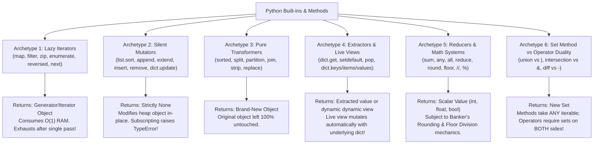
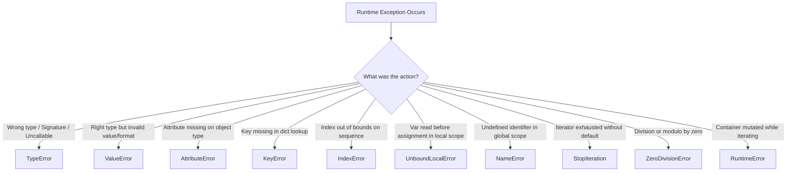

# Master Function, Method & Error Bank: Behavioral Mental Models for Certification

> **BCPD Python Certification — Advanced Architecture & Exam Engineering**  
> **Target Audience:** Developers preparing for certification with a background in general programming (JavaScript, C++, Java).  
> **Key Mission:** Inoculate against tricky exam pitfalls by mastering exact signatures, expected argument types, return values (iterators vs copies vs `None`), and precise error triggers.

---

## 1. Executive Behavioral Model: The 6 Return Archetypes

Never memorize functions as random names. In CPython, every function or method belongs strictly to one of **6 Behavioral Return Archetypes**:



---

## 2. Archetype 1: The Lazy Iterators ($O(1)$ RAM, Single-Pass Exhaustion)

*The Big Rule:* Lazy iterators evaluate on-demand during iteration. They do **not** allocate memory up front, cannot be indexed (`it[0]` is a `TypeError`), have no length (`len(it)` is a `TypeError`), and become completely empty after one iteration pass.

### 1. `map(func, *iterables)`
- **Arguments:**
  - `func`: Callable accepting $N$ arguments, where $N$ matches the number of iterables passed.
  - `*iterables`: 1 or more iterables (lists, tuples, strings).
- **Return Value:** `<map object>` (lazy iterator).
- **CPython Mechanic:** Iterates until the **shortest** iterable is exhausted. If `func` is uncallable, `map()` does not fail upon creation; it raises `TypeError` on the first `next()` call.
- **Exam Trap & Scenario:**
  ```python
  # Dynamic Scenario: Data Transformer
  nums = [1, 2, 3]
  res = map(lambda x: x * 2, nums)
  print(list(res))  # [2, 4, 6]
  print(list(res))  # [] <-- TRAP: Already exhausted!
  ```
- **Error Modes:**
  - `TypeError: 'map' object is not subscriptable` (when writing `res[0]`).
  - `TypeError: <lambda>() missing 1 required positional argument` (when iterables count does not match parameter count).

### 2. `filter(function_or_none, iterable)`
- **Arguments:**
  - `function_or_none`: A predicate callable returning truthy/falsy, **or `None`**.
  - `iterable`: Exactly one iterable.
- **Return Value:** `<filter object>` (lazy iterator).
- **CPython Mechanic:** When the first argument is `None`, Python removes all falsy values (`0`, `""`, `None`, `False`, `[]`, `{}`).
- **Exam Trap & Scenario:**
  ```python
  raw = [0, "alpha", "", None, 42, False]
  clean = list(filter(None, raw))
  # Result: ['alpha', 42]
  ```
- **Error Modes:**
  - `TypeError: filter expected 2 arguments, got 1` (unlike JS `arr.filter(fn)`, in Python it is `filter(fn, arr)`).
  - `TypeError: object of type 'filter' has no len()`.

### 3. `zip(*iterables, strict=False)`
- **Arguments:** Any number of iterables. Optional keyword-only `strict=True` (Python 3.10+).
- **Return Value:** `<zip object>` yielding tuples: `(it1[0], it2[0], ...)`.
- **CPython Mechanic:** By default (`strict=False`), silently truncates to the shortest iterable length.
- **Exam Trap & Scenario:**
  ```python
  keys = ["a", "b"]
  vals = [1, 2, 3, 4]
  pairs = list(zip(keys, vals))
  # Result: [('a', 1), ('b', 2)] -- vals[2] and vals[3] silently dropped!
  ```
- **Error Modes:**
  - `ValueError: zip() argument 2 is longer than argument 1` (when `strict=True` is provided and lengths diverge).

### 4. `enumerate(iterable, start=0)`
- **Arguments:** An iterable, plus optional integer `start` offset (default `0`).
- **Return Value:** `<enumerate object>` yielding `(index, element)`.
- **Exam Trap & Scenario:**
  ```python
  items = ["apple", "banana"]
  list(enumerate(items, start=10))
  # Result: [(10, 'apple'), (11, 'banana')]
  ```
- **Error Modes:**
  - `ValueError: not enough values to unpack (expected 3, got 2)` (if attempting `for a, b, c in enumerate(items):`).

### 5. `reversed(seq)`
- **Arguments:** A sequence implementing `__reversed__()` or `__len__()` + integer `__getitem__()`.
- **Return Value:** `<reversed object>` iterator.
- **Exam Trap & Scenario:**
  - Works on lists, tuples, strings, and Python 3.8+ dicts (reverses keys).
  - **Fails on sets and generators!**
  ```python
  s = {1, 2, 3}
  reversed(s)  # TypeError: 'set' object is not reversible
  ```

### 6. `next(iterator[, default])`
- **Arguments:** An iterator object, optional default value.
- **Return Value:** Next item from iterator, or `default` if exhausted.
- **Exam Trap & Scenario:**
  ```python
  it = iter([10])
  print(next(it))           # 10
  print(next(it, "DONE"))   # 'DONE'
  print(next(it))           # StopIteration Exception!
  ```

---

## 3. Archetype 2: The Silent Mutators (Strictly Return `None`)

*The Big Rule:* In CPython, methods that mutate a mutable data structure in place **always return `None`**. This design prevents confusing method chaining. Assigning the result of an in-place mutation immediately binds the variable to `None`!

| Method Call | Arguments Expected | Target Mutated? | Return Value | Exam Error When Subscripted |
|:---|:---|:---:|:---:|:---|
| `list.sort(key=None, reverse=False)` | Optional key func & bool | In-place | `None` | `res = l.sort(); res[0]` -> `TypeError: 'NoneType' object is not subscriptable` |
| `list.append(item)` | Any single object | In-place | `None` | `res = l.append(1); res.append(2)` -> `AttributeError: 'NoneType' has no attribute 'append'` |
| `list.extend(iterable)` | Any single iterable | In-place | `None` | `x = [1]; x.extend([2,3])` (returns `None`) |
| `list.insert(index, item)` | `int` index, any item | In-place | `None` | **Out-of-bounds does NOT error!** Clips to start or end! |
| `list.remove(value)` | Value to remove | In-place | `None` | Raises `ValueError: list.remove(x): x not in list` |
| `list.reverse()` | None | In-place | `None` | `res = l.reverse()` -> `res is None` |
| `dict.update([other])` | Dict or iterable of pairs | In-place | `None` | `d = {}.update({'a': 1})` -> `d is None` |
| `dict.clear()` | None | In-place | `None` | Empties dictionary in-place |
| `set.add(elem)` | Hashable object | In-place | `None` | Raises `TypeError: unhashable type: 'list'` if unhashable |
| `set.discard(elem)` | Any object | In-place | `None` | **Silent No-Op if missing!** Never raises error |
| `set.remove(elem)` | Element to remove | In-place | `None` | **Raises `KeyError` if element is missing!** |

### Critical Mutation Traps:
1. **`list.insert(index, x)` Never Raises `IndexError`:**
   ```python
   a = [10, 20]
   a.insert(999, 30)   # Inserts at the END! Result: [10, 20, 30]
   a.insert(-999, 5)   # Inserts at the BEGINNING! Result: [5, 10, 20, 30]
   ```
2. **`set.remove(x)` vs `set.discard(x)`:**
   ```python
   s = {1, 2}
   s.discard(99)  # Returns None. No error raised!
   s.remove(99)   # KeyError: 99!
   ```

---

## 4. Archetype 3: Pure Transformers (Return Brand-New Objects)

*The Big Rule:* These functions and methods **never alter the original object**. They construct and return a new instance in memory.

### 1. `sorted(iterable, key=None, reverse=False)`
- **Contrast with `list.sort()`:**
  - `list.sort()` requires a list and returns `None`.
  - `sorted()` works on **any** iterable (tuples, strings, dicts, sets, generators) and **always returns a brand-new `list`**.
  ```python
  d = {"c": 3, "a": 1, "b": 2}
  print(sorted(d))  # ['a', 'b', 'c'] (Sorts keys!)
  ```
- **Error Mode:** `TypeError: '<' not supported between instances of 'str' and 'int'` if sorting unorderable mixed types.

### 2. Sequence Slicing: `seq[start:stop:step]`
- **The Out-of-Bounds Invariant:**
  - Direct indexing `seq[index]` raises `IndexError` if out of bounds.
  - Slicing `seq[start:stop]` **never raises `IndexError`**; it gracefully returns an empty sequence or clips to existing bounds!
  ```python
  s = "Python"
  # print(s[100])      # IndexError: string index out of range!
  print(s[100:200])    # "" (Empty string! Never errors)
  print(s[:1000])      # "Python"
  ```

### 3. `str.split(sep=None, maxsplit=-1)`
- **The Whitespace Splitting Trap:**
  ```python
  s = "   a    b   c   "
  # CASE A: Default (sep=None) -> Runs of ANY whitespace grouped, trims ends!
  print(s.split())       # ['a', 'b', 'c']
  
  # CASE B: Explicit sep=' ' -> Splits on EVERY literal space, preserves blanks!
  print(s.split(" "))    # ['', '', '', 'a', '', '', '', 'b', '', '', 'c', '', '', '']
  ```
- **Error Mode:** `ValueError: empty separator` when calling `s.split("")`. To get characters, use `list(s)`.

### 4. `str.partition(sep)`
- **Arguments:** Substring separator.
- **Return Value:** Exactly a 3-tuple: `(head, sep, tail)`.
- **CPython Mechanic:** Never raises an error if `sep` is missing!
  ```python
  s = "user@domain.com"
  print(s.partition("@"))   # ('user', '@', 'domain.com')
  print(s.partition("#"))   # ('user@domain.com', '', '') <-- Never errors!
  ```

### 5. `str.find(sub)` vs `str.index(sub)`
- **`s.find(sub)`:** Returns index of first occurrence, or **`-1`** if missing (strings only).
- **`s.index(sub)`:** Returns index, but raises **`ValueError`** if missing (works on strings, lists, tuples).

### 6. `str.join(iterable)`
- **Arguments:** Iterable of **strings only**.
- **Return Value:** New concatenated string.
- **Error Mode:** `TypeError: sequence item 0: expected str instance, int found`.
  ```python
  # BUG:
  "-".join([1, 2, 3])  # TypeError!
  # FIX:
  "-".join(map(str, [1, 2, 3]))  # "1-2-3"
  ```

---

## 5. Archetype 4: Safe Extractors & Dynamic Dictionary Views

### Extraction Methods Matrix
| Tool | Signature | When Key/Index Found | When Target Missing | Modifies Structure? |
|:---|:---|:---|:---|:---:|
| `dict[k]` | Subscript | Returns value | ❌ Raises `KeyError` | No |
| `dict.get(k[, default])` | Safe lookup | Returns value | ✅ Returns `default` (or `None`) | No |
| `dict.setdefault(k, default)` | Insert if absent | Returns existing value | ✅ Inserts `k: default` and returns `default` | Yes (if absent) |
| `dict.pop(k[, default])` | Safe remove | Returns popped value | ❌ Raises `KeyError` **only if** `default` omitted | Yes |
| `list.pop([index=-1])` | Safe remove | Returns popped element | ❌ Raises `IndexError` on empty list or bad index | Yes |

### The Dynamic Dictionary View Trap (`.keys()`, `.values()`, `.items()`)
In Python 3, `d.keys()`, `d.values()`, and `d.items()` return **dynamic view objects**, not lists:
```python
d = {"a": 1, "b": 2}
keys_view = d.keys()
d["c"] = 3
print(keys_view)  # dict_keys(['a', 'b', 'c']) <-- Live view mutated automatically!
```
- **Error Mode:** Mutating a dictionary while actively iterating over it raises:
  `RuntimeError: dictionary changed size during iteration`.

---

## 6. Archetype 5: Reducers, Aggregators & Number Systems

### 1. `sum(iterable, /, start=0)`
- Returns accumulated numeric total.
- **Exam Trap:** `sum(["a", "b"])` raises `TypeError: unsupported operand type(s) for +: 'int' and 'str'`. Python explicitly forbids using `sum()` on strings. Use `''.join()`.

### 2. `all(iterable)` and `any(iterable)`
- **Vacuous Truth Laws:**
  - `all([])` is **`True`** (there is no element that is falsy).
  - `any([])` is **`False`** (there is no element that is truthy).

### 3. `round(number[, ndigits])` (Banker's Rounding Invariant)
Python 3 uses **Round half to even** to prevent statistical drift:
- `round(2.5)` -> `2` (rounds to nearest EVEN integer!)
- `round(3.5)` -> `4` (rounds to nearest EVEN integer!)
- *JavaScript Contrast:* In JS, `Math.round(2.5)` is `3`. In Python, `round(2.5)` is `2`!

### 4. Integer Division `//` vs Modulo `%` with Negatives
In Python, integer division floors towards **negative infinity** ($-\infty$), and `%` always takes the **sign of the divisor**:
```python
# Division:
print(7 // 2)    # 3
print(-7 // 2)   # -4  (floored toward -infinity, NOT -3!)
print(int(-3.5)) # -3  (int() truncates towards zero)

# Modulo:
print(7 % 2)     # 1
print(-7 % 2)    # 1   (Python: sign matches divisor +2! In JS: -7 % 2 is -1)
print(7 % -2)    # -1  (sign matches divisor -2!)
```

---

## 7. Archetype 6: Set Method vs Operator Duality

Set operations have a critical syntactic asymmetry between **methods** and **operators**:

| Operation | Operator Syntax | Method Syntax | Key Difference |
|:---|:---:|:---:|:---|
| Union | `s1 \| s2` | `s1.union(s2)` | Operator requires **both** to be sets; method takes **any** iterable! |
| Intersection | `s1 & s2` | `s1.intersection(s2)` | `s1 & [1, 2]` -> `TypeError`; `s1.intersection([1, 2])` -> OK! |
| Difference | `s1 - s2` | `s1.difference(s2)` | Operator requires sets; method accepts lists, tuples, dicts, generators |
| Symmetric Diff | `s1 ^ s2` | `s1.symmetric_difference(s2)` | Operator requires sets; method accepts any iterable |

*Exam Trap Snippet:*
```python
s = {1, 2}
# CASE A: Method accepts list
print(s.union([2, 3]))  # {1, 2, 3} (Valid!)

# CASE B: Operator fails on list
print(s | [2, 3])       # TypeError: unsupported operand type(s) for |: 'set' and 'list'
```

---

## 8. The Exam Error Autopsy: 10 Core Exceptions

When an exam question presents 4 code choices and asks: *"What exception is raised?"*, use this instant diagnostic guide:



### Exact Trigger Scenarios

| Exception | The Exam Trigger (What the author wrote) | Exact Verification Code |
|:---|:---|:---|
| **`TypeError`** | 1. Uncallable invoked: `x = 5; x()`<br>2. Incompatible types: `"a" + 1`<br>3. Unhashable type in set/dict: `{[1]: 'val'}`<br>4. Subscripting in-place return: `l.sort()[0]` | `res = [1].append(2); res[0]` |
| **`ValueError`** | 1. Bad parse: `int("abc")`<br>2. Missing value in list: `[1, 2].remove(99)`<br>3. Missing substring: `"abc".index("z")`<br>4. Unpack mismatch: `a, b = [1, 2, 3]` | `a, b = [1]` |
| **`AttributeError`** | Calling a method that does not exist for that type | `(1, 2).append(3)` (tuples immutable) or `"abc".sort()` |
| **`KeyError`** | 1. Missing dict key via `d[k]` or `d.pop(k)`<br>2. Missing set element via `s.remove(x)` | `d = {}; _ = d["non_existent"]` |
| **`IndexError`** | Sequence subscript out of range | `[][0]` or `[1, 2][5]` or `[].pop()` |
| **`UnboundLocalError`** | Assigning to a variable *after* referencing it in the same function | `x = 10`<br>`def f(): print(x); x = 20` |
| **`NameError`** | Accessing a variable name that was never defined anywhere | `print(unassigned_variable_name)` |
| **`StopIteration`** | Calling `next(it)` on an exhausted iterator without a default | `it = iter([]); next(it)` |
| **`ZeroDivisionError`**| Float or integer `/`, `//`, or `%` with right-hand operand zero | `10 % 0` or `5 // 0` |
| **`RuntimeError`** | Mutating a dictionary while looping through its keys/items | `d = {'a': 1}; for k in d: d['b'] = 2` |

---

## 9. JavaScript vs Python Cognitive Bridge (For JS Developers)

If you have a background in JavaScript, memorize these 7 critical paradigm shifts:

| Concept | JavaScript Behavior | Python Behavior |
|:---|:---|:---|
| **`sort()` Return** | Mutates and returns array: `arr.sort()` | Mutates and **returns `None`**: `list.sort() is None` |
| **`map()` Return** | Returns new Array immediately: `[2, 4]` | Returns **lazy one-time iterator**: `<map object>` |
| **Array Slicing** | `arr.slice(start, end)` | `arr[start:end]` (Gracefully handles out-of-bounds) |
| **Truthiness of Empty Containers** | `[]` and `{}` are **TRUTHY** (`Boolean([]) === true`) | `[]`, `{}`, `set()`, `""` are **FALSY** (`bool([]) is False`) |
| **Equality Check** | `==` (loose with coercion), `===` (strict value/type) | `==` (strict value comparison via `__eq__`), `is` (identity / memory address) |
| **Negative Modulo** | `-7 % 2 === -1` (takes sign of dividend) | `-7 % 2 == 1` (takes **sign of divisor**) |
| **Rounding Half-way** | `Math.round(2.5) === 3` (rounds up) | `round(2.5) == 2` (**Banker's rounding to even**) |
