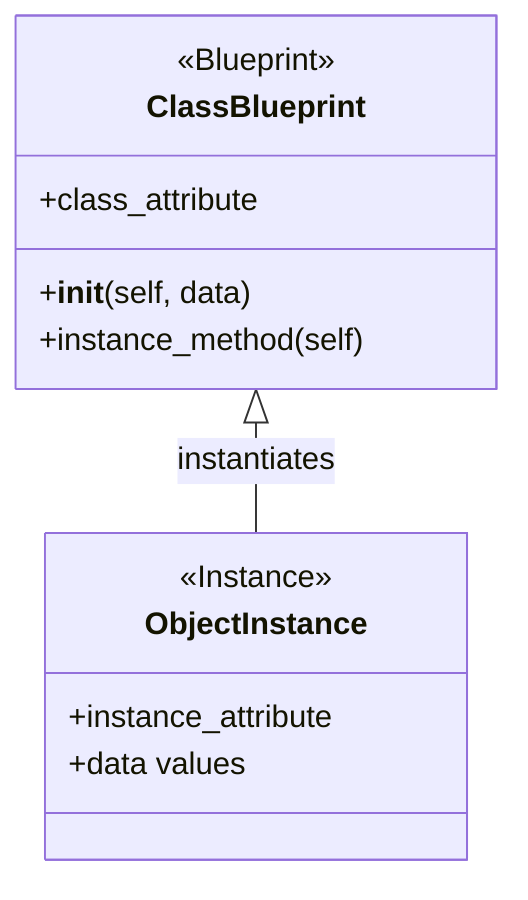

# Module 12: Object-Oriented Programming — Classes, Objects & Encapsulation

> **BCPD Python Certification — Domain 3: Object-Oriented Programming (15%)**  
> **Student Manual Reference:** Day 10 (§10.1–10.10)  
> **Classroom Source Slides:** `D9-01` to `D9-11` (Week 2 • Day 9: Tuesday 17 Nov 2026)  
> **Core Theme:** *Model real things as classes with their own data, behaviour, and protected internals.*

---

## 1. Why Object-Oriented Programming? (`§10.1`) `[Course: D9-04]`

Object-Oriented Programming (OOP) is a programming paradigm that organizes software design around data (attributes) and behavior (methods), rather than functions and sequential logic alone.



1. **Class**: A blueprint or prototype from which individual objects are created. Defines the state structure (attributes) and available operations (methods).
2. **Object**: A concrete instance built from a class, holding its own independent attribute values in memory.
3. **Encapsulation**: Bundling data together with the functions that operate on that data, while restricting direct access to internal implementation details.
4. **Roadmap**: Inheritance (subclassing) and Polymorphism (common interfaces) build directly on class fundamentals.

---

## 2. Defining a Class: `__init__` and `self` (`§10.2–10.3`) `[Course: D9-05]`

### 2.1 The Class Syntax & Constructor
- **Naming Convention**: Classes use **PascalCase** (e.g. `BankAccount`, `UserAccount`), as specified in PEP 8.
- **The Initializer (`__init__`)**: The initialization method (`__init__`) is invoked automatically by Python whenever a new instance is instantiated.
- **The `self` Parameter**:
  - `self` represents the specific instance being created or operated upon.
  - Python automatically binds and passes the newly created object as the first argument to `__init__` and any instance method.
- **Attribute Assignment**: Attributes are created dynamically in `__init__` by assigning to `self.attribute_name`.
- **Introspection**: `type(acct).__name__` evaluates to the string name of the class (`'BankAccount'`).

```python
# ORIGINAL CLASSROOM CODE [Course: D9-05]
class BankAccount:
    def __init__(self, owner, balance=0):
        self.owner = owner
        self.balance = balance

    def deposit(self, amount):
        self.balance += amount
        return self.balance

acct = BankAccount("Ada", 100)
print(acct.owner, acct.balance)       # -> Ada 100
print(acct.deposit(50))               # -> 150
print(type(acct).__name__)            # -> BankAccount
```

---

## 3. Instance Methods & Method Calls (`§10.4`) `[Course: D9-09]`

### 3.1 Method Invocation & The `self` Duality
In Python, invoking an instance method through an object:
```python
obj.method(arg)
```
is syntactically translated by the runtime to:
```python
Type(obj).method(obj, arg)
```

### 3.2 Forgetting `self` — The Number One Method Trap!
If an instance method is defined without `self`:
```python
class Broken:
    def ping():
        print("pong")

b = Broken()
b.ping()
# TypeError: Broken.ping() takes 0 positional arguments but 1 was given
```
Why? Because `b.ping()` automatically attempts to pass `b` as the first argument! Since `ping` defined zero parameters, Python raises `TypeError`.

### 3.3 Method Chaining by Returning `self`
Methods that modify an object in place can return `self`, enabling callers to chain calls cleanly:

```python
# ORIGINAL CLASSROOM CODE [Course: D9-09]
class Clicker:
    def __init__(self):
        self.count = 0

    def click(self, step=1):
        self.count += step
        return self                   # enables chaining

c = Clicker()
c.click().click(5)
print(c.count)                        # -> 6
Clicker.click(c)                      # same as c.click()
print(c.count)                        # -> 7
```

---

## 4. Class Attributes vs Instance Attributes (`§10.5`) `[Course: D9-08]`

Understanding attribute lookup resolution is one of the most heavily tested topics on the BCPD certification exam.

### 4.1 Lookup Order & Namespace Shadowing
1. **Lookup Order**: When accessing `obj.attr`, Python checks:
   - First: The **instance's own dictionary** (`obj.__dict__`).
   - Second: The **class's dictionary** (`type(obj).__dict__`).
   - Third: Base classes in the Method Resolution Order (MRO).
2. **Assigning via an Instance**:
   `obj.attr = value` **always writes to the instance namespace** (`obj.__dict__`). It does NOT touch the class attribute! This "shadows" (masks) the class attribute for that specific instance.

### 4.2 The Shared Mutable Class Attribute Trap!
> [!CAUTION]
> **Major Certification Exam Trap: Mutable Class Attributes**  
> If a mutable object (like a `list` or `dict`) is declared directly in the class body, it is shared across **every single instance** of that class! Mutating it through one instance alters it for all instances!
> **The Fix**: Always initialize mutable collections inside `__init__` on `self`!

```python
# ORIGINAL CLASSROOM CODE [Course: D9-08]
class Dog:
    species = "Canis familiaris"      # class attribute: shared immutable string
    tricks = []                       # shared mutable list: a trap!

    def __init__(self, name):
        self.name = name              # instance attribute

a, b = Dog("Rex"), Dog("Fido")
a.tricks.append("sit")
print(b.tricks)                       # -> ['sit'] (b sees the trick added by a!)

a.species = "wolf"                    # creates an instance attribute on 'a' only
print(a.species, b.species)           # -> wolf Canis familiaris
print(Dog.species)                    # -> Canis familiaris (class untouched)
```

---

## 5. Dunder (Magic) Methods (`§10.6`) `[Course: D9-07]`

Double-underscore ("dunder") methods implement Python's data model protocols, allowing custom objects to integrate seamlessly with built-in functions, operators, and formatting.

| Dunder Method | Trigger / Built-in | Purpose & Audience | Fallback Behavior |
|---|---|---|---|
| `__str__(self)` | `print(obj)`, `str(obj)`, `f"{obj}"` | Readable, user-facing representation | Falls back to `__repr__` if omitted |
| `__repr__(self)` | REPL display, `repr(obj)`, `f"{obj!r}"` | Unambiguous, developer-facing; ideally valid Python code | Default returns `<ClassName object at 0x...>` |
| `__eq__(self, other)` | `obj1 == obj2` | Value equality check | Default falls back to object identity (`is`) |
| `__len__(self)` | `len(obj)` | Must return a non-negative integer | Raises `TypeError: object of type '...' has no len()` |

```python
# ORIGINAL CLASSROOM CODE [Course: D9-07]
class Book:
    def __init__(self, title, pages):
        self.title, self.pages = title, pages

    def __str__(self):
        return f"{self.title} ({self.pages}p)"

    def __repr__(self):
        return f"Book({self.title!r}, {self.pages})"

    def __eq__(self, other):
        return self.title == other.title

    def __len__(self):
        return self.pages

b = Book("Dune", 412)
print(b)                              # -> Dune (412p)
print(repr(b))                        # -> Book('Dune', 412)
print(len(b), b == Book("Dune", 1))   # -> 412 True
```

---

## 6. Encapsulation: Protected & Private (`§10.7`) `[Course: D9-06, D9-11]`

### 6.1 Naming Conventions & Name Mangling
Python does not feature strict hardware/compiler access specifiers like C++ or Java (`private`, `protected`). Instead, Python relies on explicit naming conventions and runtime name mangling:

1. **Public (`x`)**: Accessible anywhere.
2. **Protected (`_x`)**:
   - Single leading underscore is a **developer convention**: *"Internal implementation detail — do not access or override from outside this class."*
   - Still physically accessible from outside the class, but linters and type checkers flag direct access.
3. **Private (`__x`)**:
   - Double leading underscore (without trailing double underscores) triggers **Name Mangling**.
   - The Python compiler renames `__x` internally to `_ClassName__x`.
   - **Purpose**: Prevents accidental name collisions in subclasses and prevents accidental overrides.
   - **Not Cryptographic Security**: External callers can still access `obj._ClassName__x`, but attempting to access `obj.__x` directly raises `AttributeError`!

```python
# ORIGINAL CLASSROOM CODE [Course: D9-06]
class Account:
    def __init__(self, balance):
        self._owner = "Ada"           # protected convention
        self.__balance = balance      # private (mangled to _Account__balance)

    def withdraw(self, amount):
        if amount > self.__balance:
            raise ValueError("Insufficient funds")
        self.__balance -= amount
        return self.__balance

acc = Account(100)
print(acc.withdraw(30))               # -> 70
print(acc._Account__balance)          # -> 70 (accessing mangled name)
print(acc._owner)                     # -> Ada
# acc.__balance raises AttributeError: 'Account' object has no attribute '__balance'
```

### 6.2 The Complete Access Matrix `[Course: D9-11]`

| Identifier | Kind | Inside Class | In Subclass | From Outside |
|---|---|:---:|:---:|---|
| `x` | **Public** | `✓ self.x` | `✓ self.x` | `✓ obj.x` |
| `_x` | **Protected** (convention) | `✓ self._x` | `✓ self._x` | Works, but violates convention |
| `__x` | **Private** (name-mangled) | `✓ self.__x` | `✗ stored as _Parent__x` | `✗ AttributeError`; `obj._Cls__x` works |
| `__x__` | **Special** (dunder) | Not mangled | `✓ self.__x__` | `✓ obj.__x__` |

---

## 7. Managed Attributes: `@property`, Getters & Setters (`§10.8`) `[Course: D9-10]`

### 7.1 Pythonic Attribute Access
In Python, you do not write Java-style `get_celsius()` and `set_celsius()` methods. Instead, start with simple public attributes (`t.celsius = 25`). If validation, computed fields, or caching are needed later, use the `@property` decorator **without breaking the caller's attribute-style syntax**!

### 7.2 Read-Only Properties
A property defined with `@property` but **without** a matching `@<name>.setter` becomes **read-only**:
Attempting to assign to it raises `AttributeError: can't set attribute`.

```python
# ORIGINAL CLASSROOM CODE [Course: D9-10]
class Temperature:
    def __init__(self, celsius):
        self.celsius = celsius        # runs the setter!

    @property
    def celsius(self):
        return self._celsius

    @celsius.setter
    def celsius(self, value):
        if value < -273.15:
            raise ValueError("Below absolute zero")
        self._celsius = value

    @property
    def fahrenheit(self):             # read-only property
        return self._celsius * 9 / 5 + 32

t = Temperature(25)
t.celsius = 30
print(t.celsius, t.fahrenheit)        # -> 30 86.0

# t.fahrenheit = 100 raises AttributeError: can't set attribute (or property 'fahrenheit' has no setter)
```

---

## 8. Lab 9.1 — Full BankAccount Class Architecture

Putting together everything from Day 9 into an enterprise-ready model:
- `owner`: public or protected with getter.
- `balance`: private, guarded by `@property` and validation methods.
- Methods: `deposit`, `withdraw`, `transfer_to`.
- Dunders: `__repr__`, `__str__`, `__eq__`.

```python
class BankAccount:
    """Enterprise Bank Account with full encapsulation and validation."""
    _interest_rate = 0.03  # Class attribute

    def __init__(self, owner: str, initial_balance: float = 0.0):
        if initial_balance < 0:
            raise ValueError("Initial balance cannot be negative")
        self.owner = owner
        self.__balance = float(initial_balance)
        self.__transactions = []

    @property
    def balance(self) -> float:
        return self.__balance

    def deposit(self, amount: float) -> float:
        if amount <= 0:
            raise ValueError("Deposit amount must be positive")
        self.__balance += amount
        self.__transactions.append(("DEPOSIT", amount))
        return self.__balance

    def withdraw(self, amount: float) -> float:
        if amount <= 0:
            raise ValueError("Withdrawal amount must be positive")
        if amount > self.__balance:
            raise ValueError("Insufficient funds")
        self.__balance -= amount
        self.__transactions.append(("WITHDRAW", amount))
        return self.__balance

    def __repr__(self) -> str:
        return f"BankAccount(owner={self.owner!r}, balance={self.__balance})"

    def __str__(self) -> str:
        return f"Account[{self.owner}]: ${self.__balance:,.2f}"

    def __eq__(self, other) -> bool:
        if not isinstance(other, BankAccount):
            return NotImplemented
        return self.owner == other.owner and self.__balance == other.__balance
```
