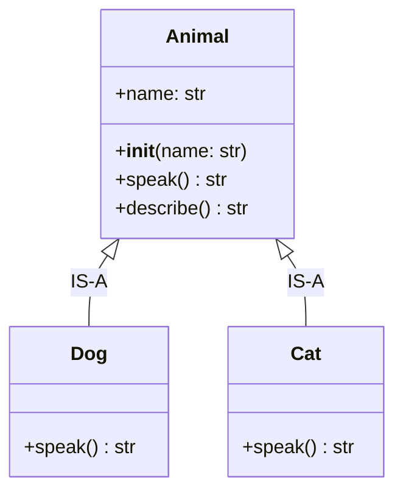
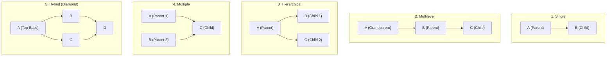
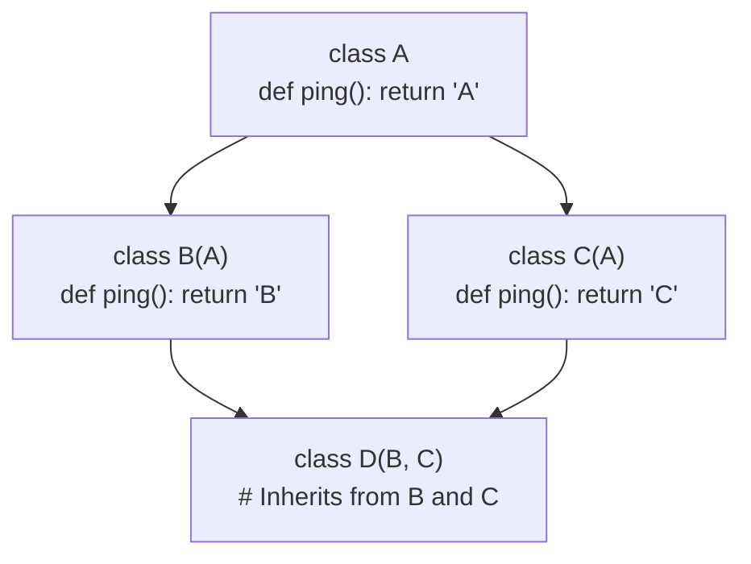
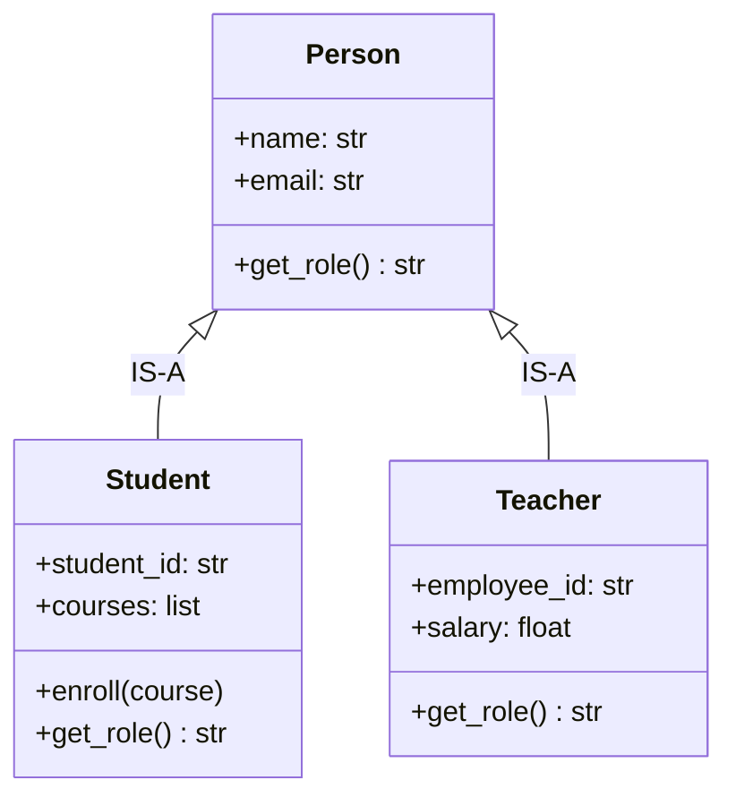

# Module 13: Object-Oriented Programming — Inheritance & the MRO

> **BCPD Python Certification — Domain 3: Object-Oriented Programming (15%)**  
> **Student Manual Reference:** Day 11 (§11.1–11.10)  
> **Classroom Source Slides:** `D10-01` to `D10-07` (Week 2 • Day 10: Wednesday 18 Nov 2026)  
> **Core Theme:** *Reuse and extend classes with inheritance, super(), overriding, abstract bases, and dataclasses.*

---

## 1. Inheritance: The IS-A Relationship (`§11.1`) `[Course: D10-01, D10-03]`

Inheritance allows a new class (derived/child class) to inherit attributes and methods from an existing class (base/parent class).



### 1.1 Core Rules of Inheritance:
1. **Syntax**: `class Dog(Animal):` — Parent class is specified inside parentheses after the class name.
2. **Behavior Inheritance**: The child class automatically inherits all methods and attributes defined on the parent.
3. **Specialization**: The child can add new methods or **override** existing ones.
4. **Universal Base**: In Python 3, every class implicitly or explicitly inherits from `object`.
5. **Architectural Rule**: Inherit only for true **IS-A** relationships (e.g. *A Dog is an Animal*). If the relationship is *HAS-A* (e.g. *A Car has an Engine*), use **Composition** instead.

```python
# ORIGINAL CLASSROOM CODE [Course: D10-03: animals.py]
class Animal:
    def __init__(self, name):
        self.name = name

    def speak(self):
        return "..."

    def describe(self):
        return f"{self.name} says {self.speak()}"


class Dog(Animal):
    def speak(self):
        return "Woof"  # override


class Cat(Animal):
    def speak(self):
        return "Meow"  # override


print(Dog("Rex").describe())  # Rex says Woof
print(Cat("Tom").describe())  # Tom says Meow
```

---

## 2. The 6 Types of Inheritance in Python (`§11.1`) `[Course: D10-04]`

Python supports comprehensive inheritance hierarchies:



| Type | Structure & Syntax | Characteristics |
|---|---|---|
| **1. Single** | `class B(A): pass` | One child inherits directly from one parent. Simplest and most common pattern. |
| **2. Multilevel** | `class B(A): pass`<br>`class C(B): pass` | A chain of generations (`A -> B -> C`). Class `C` inherits features from both `B` and `A`. |
| **3. Hierarchical** | `class B(A): pass`<br>`class C(A): pass` | Several child classes share the same parent class. |
| **4. Multiple** | `class C(A, B): pass` | One child inherits from two or more parent classes. Lookup order is determined by the MRO. |
| **5. Hybrid** | Mixed patterns (e.g. Diamond:<br>`class B(A): pass`<br>`class C(A): pass`<br>`class D(B, C): pass`) | Combines multiple and hierarchical inheritance. Resolved deterministically by Python's C3 Linearization algorithm. |
| **6. Inspection** | Tools to inspect hierarchies | `help(D)`, `D.__mro__`, `D.mro()`, `D.__bases__`, `issubclass(D, A)`. |

---

## 3. Calling Parent Behavior with `super()` (`§11.2`) `[Course: D10-05]`

The built-in function `super()` returns a proxy object that delegates method calls to the next class in the Method Resolution Order (MRO) — usually the parent class.

### 3.1 The `super().__init__()` Imperative
When a subclass defines its own `__init__()`, Python does **NOT** automatically call the parent's `__init__()`. You must call it explicitly using `super().__init__(...)`.

> [!WARNING]
> **The Forgotten Initializer Trap:**
> If a subclass defines `__init__` and forgets to invoke `super().__init__(...)`, the parent's instance attributes are **never created**! Subsequent access to those attributes will raise an immediate `AttributeError`.

### 3.2 Extending vs. Overwriting Methods
Instead of copying and pasting the parent's implementation, use `super().method(...)` to build upon it:

```python
# ORIGINAL CLASSROOM CODE [Course: D10-05: staff.py]
class Employee:
    def __init__(self, name, salary):
        self.name = name
        self.salary = salary

    def pay(self):
        return self.salary


class Manager(Employee):
    def __init__(self, name, salary, bonus):
        super().__init__(name, salary)  # reuse parent setup!
        self.bonus = bonus

    def pay(self):
        return super().pay() + self.bonus  # extend parent logic!


m = Manager("Ada", 5000, 800)
print(m.name, m.pay())  # Ada 5800
```

---

## 4. Method Overriding & The Shared Template Pattern (`§11.3`) `[Course: D10-06]`

Method overriding occurs when a child class provides a specific implementation of a method that is already defined in its parent class.

### 4.1 How Method Lookup Works:
1. Python searches the instance dictionary (`obj.__dict__`).
2. If not found, Python searches the object's class (`type(obj)`).
3. If not found, Python traverses the MRO up through base classes.
4. The first implementation encountered **wins**.

### 4.2 The Shared Template (Template Method Pattern):
A parent class can define a workflow or representation in terms of helper methods that subclasses override:

```python
# ORIGINAL CLASSROOM CODE [Course: D10-06: shapes.py]
class Shape:
    def area(self):
        return 0

    def __str__(self):
        # Calls self.area() on whatever concrete subclass the object is!
        return f"{type(self).__name__}: {self.area():.2f}"


class Circle(Shape):
    def __init__(self, r):
        self.r = r

    def area(self):
        return 3.14159 * self.r ** 2


class Square(Shape):
    def __init__(self, s):
        self.s = s

    def area(self):
        return self.s ** 2


for shape in [Circle(1), Square(3)]:
    print(shape)
# Circle: 3.14
# Square: 9.00
```

---

## 5. Type Checking & Introspection: `isinstance()` vs. `type()` (`§11.4`) `[Course: D10-07]`

Python provides introspection tools to inspect object identities and class hierarchies:

```python
# ORIGINAL CLASSROOM CODE [Course: D10-07: checks.py]
class Animal: pass
class Dog(Animal): pass

d = Dog()
print(isinstance(d, Dog), isinstance(d, Animal))    # True True
print(type(d) is Animal)                            # False
print(issubclass(Dog, Animal))                      # True
print(issubclass(Dog, object))                      # True
print(Dog.__bases__)                                # (<class '__main__.Animal'>,)
print(isinstance(3, (int, float)))                  # True
```

### Critical Exam Differences:

| Operation | Syntax | Considers Subclasses? | Best Use Case |
|---|---|:---:|---|
| `isinstance(obj, Class)` | `isinstance(d, Animal)` | **YES** (`True` for `Class` and all ancestors) | Polymorphic type checks; API contract validation |
| `type(obj) is Class` | `type(d) is Animal` | **NO** (Exact type match only) | When subclasses must be strictly rejected |
| `issubclass(A, B)` | `issubclass(Dog, Animal)` | **YES** (Operates on classes, not instances) | Framework metaprogramming, class registry |
| `isinstance(x, (T1, T2))`| `isinstance(3, (int, float))`| **YES** (Accepts a tuple of types) | Union type validation |

> [!IMPORTANT]
> In Python, `bool` is a subclass of `int` (`issubclass(bool, int) is True`).
> Therefore:
> - `isinstance(True, int)` evaluates to **`True`**!
> - `type(True) is int` evaluates to **`False`**!

---

## 6. Multiple Inheritance & The Diamond Problem (`§11.5`)

When a class inherits from multiple parents, Python uses the **C3 Linearization Algorithm** to construct an unambiguous, monotonic Method Resolution Order (MRO).



### The C3 Linearization Rules:
1. Subclasses appear **before** their parent classes.
2. If a class inherits from multiple parents, their declared order is preserved (`class D(B, C)` searches `B` before `C`).
3. Each class appears in the MRO exactly **once**.

```python
class A:
    def ping(self): return "A"

class B(A):
    def ping(self): return "B"

class C(A):
    def ping(self): return "C"

class D(B, C):
    pass

d = D()
print(d.ping())  # -> "B" (B comes before C in D's definition)
print(D.mro())   # -> [D, B, C, A, object]
```

---

## 7. Constructors & Private Name Mangling Across Hierarchies (`§11.2`)

Private attributes prefixed with double underscores (`__`) undergo **name mangling**:
- In class `Parent`, `self.__value` becomes `_Parent__value`.
- In class `Child(Parent)`, `self.__value` becomes `_Child__value`.

```python
class Parent:
    def __init__(self):
        self.__secret = 42

    def get_secret(self):
        return self.__secret

class Child(Parent):
    def __init__(self):
        super().__init__()
        self.__secret = 99  # Does NOT overwrite _Parent__secret!

c = Child()
print(c.get_secret())  # -> 42 (reads _Parent__secret)
print(c._Child__secret)   # -> 99
print(c._Parent__secret)  # -> 42
```
This protects parent implementation details from accidental overwrite by subclasses.

---

## 8. Abstract Base Classes (`abc.ABC`) (`§11.6`)

When you want to define an interface contract that all subclasses **must** implement, use the standard library `abc` module:

```python
from abc import ABC, abstractmethod

class PaymentGateway(ABC):
    @abstractmethod
    def process_payment(self, amount: float) -> bool:
        """Subclasses must implement this method."""
        pass

class StripeGateway(PaymentGateway):
    def process_payment(self, amount: float) -> bool:
        return True

# If a subclass forgets to implement any abstract method:
class IncompleteGateway(PaymentGateway):
    pass

# Attempting to instantiate raises TypeError!
# IncompleteGateway() -> TypeError: Can't instantiate abstract class IncompleteGateway with abstract method process_payment
```

---

## 9. Composition vs. Inheritance & Mixins (`§11.7`)

### "IS-A" vs. "HAS-A":
- **Inheritance ("IS-A")**: Tightly couples the child to the parent. Use when the child is a genuine subtype of the parent (`Dog` is an `Animal`).
- **Composition ("HAS-A")**: Loosely couples classes by holding references to other objects. Favored in production systems: *"Favor composition over inheritance."*

```python
class Engine:
    def start(self): return "Engine roaring"

class Car:
    def __init__(self):
        self.engine = Engine()  # HAS-A relationship

    def drive(self):
        return f"{self.engine.start()} -> Car moving"
```

### Mixins:
A **Mixin** is a lightweight class intended to provide reusable methods to other classes via multiple inheritance, without defining its own instance state:

```python
class JSONSerializableMixin:
    def to_json(self):
        import json
        return json.dumps(self.__dict__)

class User(JSONSerializableMixin):
    def __init__(self, name, role):
        self.name = name
        self.role = role

u = User("Alice", "Admin")
print(u.to_json())  # {"name": "Alice", "role": "Admin"}
```

---

## 10. Dataclasses (Python 3.7+) (`§11.9`)

The `@dataclass` decorator automatically writes boilerplate dunder methods (`__init__`, `__repr__`, `__eq__`) based on type-annotated class attributes:

```python
from dataclasses import dataclass, field

@dataclass(frozen=True)  # Makes instances immutable and hashable
class Point:
    x: float
    y: float

p1 = Point(1.0, 2.0)
p2 = Point(1.0, 2.0)
print(p1)          # Point(x=1.0, y=2.0)
print(p1 == p2)    # True (automatic __eq__)
# p1.x = 5.0       # Raises FrozenInstanceError!

@dataclass
class Classroom:
    name: str
    # MUTABLE DEFAULT TRAP FIX:
    # students: list = []  # ValueError: mutable default is not allowed!
    students: list = field(default_factory=list)
```

---

## 11. Lab 10.1 — School System & Shape Hierarchy Architecture

Lab 10.1 consolidates inheritance, `super()`, abstract bases, and polymorphism:


