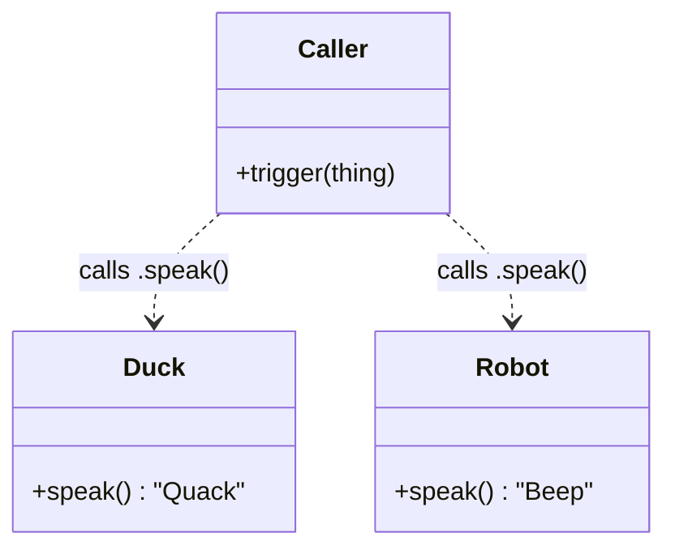

# Module 14: Object-Oriented Programming — Polymorphism, Overloading & OOP Design

> **BCPD Python Certification — Domain 3: Object-Oriented Programming (15%)**  
> **Student Manual Reference:** Day 12 (§12.1–12.6) + Day 13 (§13.1–13.5)  
> **Classroom Source Slides:** `D11-01` to `D11-08` (Week 2 • Day 11: Thursday 19 Nov 2026)  
> **Core Theme:** *One interface, many forms: duck typing, operator and function overloading, data hiding — then the design principles and patterns that keep classes clean.*

---

## 1. Polymorphism & Duck Typing (`§12.1`) `[Course: D11-01, D11-03]`

Polymorphism ("many forms") allows different objects to respond to the same method call in ways appropriate to their specific type.



### 1.1 The Duck Typing Philosophy
In Python, polymorphism is fundamentally enabled by **Duck Typing**:
> *"If it walks like a duck and quacks like a duck, it's a duck."*

- Unlike statically-typed languages (Java/C++), Python does **not** require classes to inherit from a common parent or implement an explicit interface to be used polymorphically.
- The Python runtime only checks whether the requested attribute or method exists at invocation time.

```python
# ORIGINAL CLASSROOM CODE [Course: D11-03: duck.py]
class Duck:
    def speak(self):
        return "Quack"


class Robot:                                   # completely unrelated class!
    def speak(self):
        return "Beep"


for thing in [Duck(), Robot()]:
    print(thing.speak())
# Quack
# Beep

def total_length(items):
    return sum(len(x) for x in items)

# Works across strings, lists, dicts without a shared custom base!
print(total_length(["ab", [1, 2, 3], {"k": 1}]))  # -> 6
```

---

## 2. Built-in Polymorphism Across Python Types (`§12.2`) `[Course: D11-04]`

Python's built-in operators and functions adapt their behavior based on the type of operands they receive:

| Expression | Numbers (`int`/`float`) | Strings (`str`) | Lists (`list`) | Underlying Dunder Protocol |
|---|---|---|---|---|
| `a + b` | `2 + 3` $\rightarrow$ `5` (arithmetic addition) | `"a" + "b"` $\rightarrow$ `'ab'` (concatenation) | `[1] + [2]` $\rightarrow$ `[1, 2]` (concatenation) | `__add__` |
| `a * 3` | `2 * 3` $\rightarrow$ `6` (multiplication) | `"ab" * 3` $\rightarrow$ `'ababab'` (repetition) | `[0] * 3` $\rightarrow$ `[0, 0, 0]` (repetition) | `__mul__` |
| `len(x)` | Raises `TypeError` (numbers have no length) | `len("hey")` $\rightarrow$ `3` | `len([1, 2])` $\rightarrow$ `2` | `__len__` |
| `x in y` | Raises `TypeError` (numbers are not iterable) | `"e" in "hey"` $\rightarrow$ `True` | `2 in [1, 2]` $\rightarrow$ `True` | `__contains__` |
| `max(x)` | `max(3, 9)` $\rightarrow$ `9` | `max("hey")` $\rightarrow$ `'y'` | `max([4, 1])` $\rightarrow$ `4` | `__gt__` / iterator |

---

## 3. Operator Overloading & Dunder Protocols (`§12.3`) `[Course: D11-05]`

Operator overloading allows user-defined classes to intercept and redefine Python's native operators (`+`, `-`, `*`, `<`, `==`) by implementing special dunder methods.

```python
# ORIGINAL CLASSROOM CODE [Course: D11-05: vector.py]
class Vector:
    def __init__(self, x, y):
        self.x, self.y = x, y

    def __add__(self, other):
        return Vector(self.x + other.x, self.y + other.y)

    def __mul__(self, k):
        return Vector(self.x * k, self.y * k)

    def __rmul__(self, k):                     # Reflected operator for `2 * v`!
        return Vector(self.x * k, self.y * k)

    def __eq__(self, other):
        return (self.x, self.y) == (other.x, other.y)

    def __lt__(self, other):
        return abs(self) < abs(other)

    def __abs__(self):
        return (self.x ** 2 + self.y ** 2) ** 0.5

    def __repr__(self):
        return f"Vector({self.x}, {self.y})"


v = Vector(1, 2) + Vector(3, 4)
print(v, v * 2)                               # Vector(4, 6) Vector(8, 12)
print(v == Vector(4, 6), Vector(1, 1) < v)    # True True
```

### Critical Rules for Operator Overloading:
1. **Return New Objects**: Operators should **never** mutate their operands in-place — always instantiate and return a fresh object.
2. **Reflected / Reverse Operators (`__r...__`)**:
   - When evaluating `v * 2`, Python calls `v.__mul__(2)`.
   - When evaluating `2 * v`, Python first tries `(2).__mul__(v)`. Since `int` does not know how to multiply a `Vector`, Python falls back to `v.__rmul__(2)`.
   - Without `__rmul__`, `2 * v` raises `TypeError: unsupported operand type(s)`!
3. **`functools.total_ordering`**:
   - If you define `__eq__` and one ordering dunder (e.g. `__lt__`), decorating the class with `@total_ordering` automatically synthesizes `__le__`, `__gt__`, and `__ge__`.

---

## 4. Function Overloading in Python (`§12.4`) `[Course: D11-06]`

In languages like C++ or Java, multiple functions can share the same name if their parameter signatures differ. **Python does not natively support this!**

> [!WARNING]
> **The Function Shadowing Trap:**
> In Python, defining a second function with the same name silently **overwrites and replaces** the first definition in the namespace!

```python
def area(r):
    return 3.14 * r * r

def area(w, h):                               # Silently replaces area(r)!
    return w * h

# area(2) -> Raises TypeError: area() missing 1 required positional argument: 'h'
```

### 4.1 Technique 1: Default Arguments & Varargs
```python
def area(a, b=None):
    return 3.14 * a * a if b is None else a * b

print(area(2), area(2, 3))                    # 12.56 6
```

### 4.2 Technique 2: `@functools.singledispatch`
For clean type-based dispatch, use the standard library `singledispatch` decorator:

```python
from functools import singledispatch

@singledispatch
def describe(x):
    return "something"

@describe.register
def _(x: int):
    return "an int"

@describe.register
def _(x: list):
    return f"a list of {len(x)}"

print(describe(5), describe([1, 2]), describe(2.5))
# an int a list of 2 something
```
*(For methods on a class, use `@singledispatchmethod` from Python 3.8+)*.

---

## 5. Memory Optimization & Data Hiding with `__slots__` (`§12.5`) `[Course: D11-07]`

By default, every Python instance stores its attributes in an internal dictionary called `__dict__`. While highly flexible, dictionaries carry substantial memory overhead and permit accidental typo assignments.

### Using `__slots__`:
```python
# ORIGINAL CLASSROOM CODE [Course: D11-07: slots.py]
class Free:
    pass

class Fixed:
    __slots__ = ("x", "y")
    def __init__(self, x, y):
        self.x, self.y = x, y

f = Free()
f.anything = 1
print(f.__dict__)                             # {'anything': 1}

p = Fixed(1, 2)
print(hasattr(p, "__dict__"))                 # False (No __dict__ created!)
try:
    p.z = 3
except AttributeError:
    print("AttributeError")                   # AttributeError: 'Fixed' object has no attribute 'z'
print(p.__class__.__name__)                   # Fixed
```

### Advantages of `__slots__`:
1. **Dramatic Memory Reduction**: Up to 40–50% memory savings in high-scale systems (allocates fixed C-level array pointers instead of full hash tables).
2. **Attribute Whitelist / Typo Prevention**: Prevents bugs where assigning `p.xx = 5` silently creates a new attribute instead of updating `p.x`.
3. **Caveat**: Subclasses of slotted classes also need `__slots__` declared, otherwise the child will spawn its own `__dict__`!

---

## 6. Clean Class Design: SRP & Constructor Best Practices (`§13.1`) `[Course: D11-08]`

### 6.1 The Single Responsibility Principle (SRP)
> *A class should have one, and only one, reason to change.*

- **Anti-pattern (God Object)**: A single monolithic class that handles customer state, formats HTML reports, connects to SQL databases, and sends SMTP emails.
- **Clean Architecture**: Split responsibilities: `Customer` (domain entity), `CustomerRepository` (persistence), `CustomerMailer` (notifications).

### 6.2 Fail Early in `__init__`:
Never allow an invalid object to be constructed. Validate arguments immediately inside `__init__` or dedicated helper validation methods:

```python
# ORIGINAL CLASSROOM CODE [Course: D11-08: design.py]
class Customer:
    def __init__(self, name, email, phone=None):
        self._validate_email(email)
        self.name = name
        self.email = email
        self.phone = phone

    def _validate_email(self, email):
        if "@" not in email:
            raise ValueError("Invalid email address")


c = Customer("Ada", "ada@bcpd.org")
print(c.name, c.phone)                        # Ada None
try:
    Customer("Bo", "bo.example.com")
except ValueError as e:
    print(e)                                  # Invalid email address
```

---

## 7. `@classmethod` vs `@staticmethod` in Practice (`§13.1`)

| Feature | `@classmethod` | `@staticmethod` |
|---|---|---|
| **First Parameter** | `cls` (the class object) | None (behaves like a plain function) |
| **Can Access Class State?** | Yes, via `cls` | No |
| **Supports Subclass Factories?** | **Yes** (Calling on subclass creates subclass instance) | No |
| **Primary Use Case** | Alternative constructors / factory methods (e.g. `from_string`, `from_dict`) | Pure utility functions logically scoped to the class |

```python
class Date:
    def __init__(self, year, month, day):
        self.year = year
        self.month = month
        self.day = day

    @classmethod
    def from_iso(cls, iso_str: str):
        y, m, d = map(int, iso_str.split("-"))
        return cls(y, m, d)                   # Factory constructor!

    @staticmethod
    def is_valid_year(year: int) -> bool:
        return 1900 <= year <= 2100
```

---

## 8. OOP Design Patterns: LSP & The Singleton (`§13.3`)

### 8.1 Liskov Substitution Principle (LSP):
> *Objects of a superclass should be replaceable with objects of a subclass without breaking application correctness.*

- Classic violation: `Square` inheriting from `Rectangle`. If changing `width` on `Square` forces `height` to change, code expecting an independent rectangle will fail!

### 8.2 The Singleton Pattern (Only One Instance Allowed):
```python
class DatabaseConnection:
    _instance = None

    def __new__(cls, *args, **kwargs):
        if cls._instance is None:
            cls._instance = super().__new__(cls)
        return cls._instance

db1 = DatabaseConnection()
db2 = DatabaseConnection()
assert db1 is db2  # Exactly one instance in memory!
```

---

## 9. Lab 11.1 — Matrix Class Challenge (`§Lab 11.1`)

Build a robust, mathematical 2D `Matrix` class implementing:
- Representation: `__repr__` and `__str__`
- Operator overloading: `__add__` (element-wise addition with dimension validation), `__mul__` (scalar multiplication), `__rmul__` (reflected scalar multiplication: `3 * m`)
- Equality: `__eq__` (element-wise matrix equality)
- Validation: Validates rectangular row lengths upon creation, raising `ValueError` on malformed inputs.
