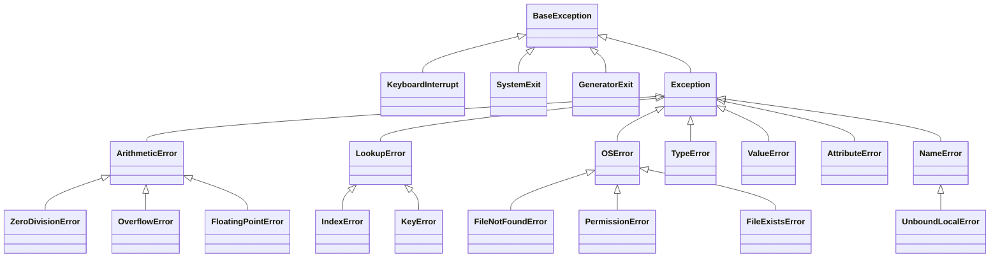

# Module 18: Exceptions, Assertions & Debugging — Domain 5 Mastery

> **BCPD Certified Python Developer Course — Cohort 2**  
> **Classroom Source:** Week 3 • Day 16 • Thursday 26 Nov 2026  
> **Certification Domain:** Domain 5: Debugging & Error Handling (15% Exam Weighting)  
> **Student Manual Reference:** Day 20 (§20.1–20.5) + Day 21 (§21.1–21.12)  
> **Teaching Mission:** *"Tell error types apart, catch exactly what you mean to, and control what runs next with else, finally, raise and assert."*

---

## 1. The Three Kinds of Errors `[Manual §20.1–20.2]`

In Python software development and certification evaluation, errors fall strictly into three categories:

| Error Type | Definition & Phase | Detection Mechanism | Handling Strategy |
|:---|:---|:---|:---|
| **Syntax Errors** | Code violates Python grammar rules (e.g. missing colon `:`, unclosed quotes, illegal tokens). Occurs at **compile-time (parsing phase)** before any bytecode executes. | Interpreter parser aborts immediately; outputs `SyntaxError` with line and column caret (`^`). | Fix code formatting; **cannot** be caught by runtime `try...except` in the same module. |
| **Runtime Exceptions** | Syntactically valid code that encounters an impossible or illegal operation while executing (e.g. `1 / 0`, missing key, wrong type). | CPython raises an `Exception` object during evaluation. | Handled gracefully using structured `try...except...else...finally` blocks. |
| **Logic Errors** | Program runs to completion with zero exceptions, but produces incorrect outputs or invalid business state (e.g. subtracting tax instead of adding it). | Silent failure; detected via automated unit tests, sanity `assert` statements, and interactive debugging. | Write deterministic assertions and tests; step through code with debugger. |

---

## 2. Common Built-in Exceptions `[Manual §20.3]`

Exam questions frequently display code snippets that abort with a traceback and ask: *"Which exception is raised?"*

| Exception | Raised When | Concrete Classroom Trigger |
|:---|:---|:---|
| **`ValueError`** | Correct data type, but invalid contents, format, or value | `int("abc")`, `[1, 2].remove(99)`, `[1, 2].index(5)` |
| **`TypeError`** | Operation applied to incompatible types or wrong argument count | `"2" + 2`, `len(5)`, calling an in-place result: `[1].sort()[0]` |
| **`IndexError`** | Sequence subscript out of range | `[1, 2][5]`, `[][0]`, `[].pop()` |
| **`KeyError`** | Missing dictionary key or missing set element during `.remove()` | `{}[ "x"]`, `set().remove(10)` |
| **`AttributeError`** | Referencing an attribute or method that does not exist on that object | `None.upper()`, `(1, 2).append(3)`, `"abc".sort()` |
| **`NameError`** | Referencing an identifier never bound in local, enclosing, global, or built-in scope | `print(undefined_variable)` |
| **`UnboundLocalError`** | Variable referenced before assignment inside local function scope (subclass of `NameError`) | `def f(): print(x); x = 1` |
| **`ZeroDivisionError`** | Float or integer division `/`, floor division `//`, or modulo `%` by zero | `1 / 0`, `5 // 0`, `10 % 0` |
| **`FileNotFoundError`** | OS file or directory lookup fails during `open()` | `open("nonexistent_file.txt", "r")` |
| **`ModuleNotFoundError`** | `import` statement fails to resolve module in `sys.path` | `import non_existent_pkg` |

---

## 3. The Exception Class Hierarchy `[Manual §20.3]`

All exceptions in Python are arranged in a strict single-inheritance tree rooted at `BaseException`.



### The 4 Hierarchy Laws for Certification:
1. **`BaseException` is the Root:** Covers system termination signals (`KeyboardInterrupt` for Ctrl+C, `SystemExit` for `sys.exit()`). **Never catch `BaseException` casually**, as it prevents stopping runaway scripts.
2. **`Exception` is the General Parent:** All normal application errors inherit from `Exception`. User-defined exceptions must inherit from `Exception` (or a subclass), **never directly from `BaseException`**.
3. **Family Groups:**
   - `LookupError`: Catches both sequence indexing (`IndexError`) and mapping lookup (`KeyError`).
   - `ArithmeticError`: Catches mathematical failures (`ZeroDivisionError`, `OverflowError`, `FloatingPointError`).
   - `OSError`: Catches system I/O errors (`FileNotFoundError`, `PermissionError`, `FileExistsError`).
4. **Be Specific (Narrowest First):** Catching a parent class automatically catches every child class below it! Placing `except LookupError:` before `except KeyError:` renders the `KeyError` handler unreachable dead code.

---

## 4. Structured Handling: `try / except / else / finally` `[Manual §20.4, §21.2, §21.3]`

### The Complete Control Flow Anatomy

```python
try:
    # 1. RISKY CODE: Keep this block as minimal as possible
    risky_operation()
except SpecificError as e:
    # 2. MATCHING ERROR: Executes if SpecificError occurred in try
    handle_specific(e)
except (TypeError, ValueError) as e:
    # 3. MULTIPLE ERRORS: Must be enclosed in a parenthesized tuple!
    handle_multiple(e)
else:
    # 4. SUCCESS WORK: Executes ONLY if NO exception occurred in try!
    # Errors raised here are NOT caught by this try-except's handlers!
    follow_up_work()
finally:
    # 5. GUARANTEED CLEANUP: Executes UNCONDITIONALLY in all circumstances!
    # Runs after success, after handled error, and after unhandled error.
    # Runs even if try executes return, break, or continue!
    release_resources()
```

### Critical Exam Rules:
- **`try...finally` without `except` is 100% valid:**
  ```python
  f = open("data.txt")
  try:
      process(f)
  finally:
      f.close()  # Guaranteed cleanup even if process() raises an unhandled error!
  ```
- **Order of Execution:**
  - Case 1 (Success): `try` -> `else` -> `finally`.
  - Case 2 (Handled Exception): `try` (up to failure) -> matching `except` -> `finally` (`else` is skipped).
  - Case 3 (Unhandled Exception): `try` (up to failure) -> `finally` -> exception propagates up stack.

---

## 5. Propagation & Nested `try` Blocks `[Manual §21.5–21.6]`

When an exception is raised, Python inspects handlers in the active stack frame. If no matching `except` clause is found, it **unrolls the call stack (propagates)** to the caller:

```python
def level3():
    return int("invalid")  # Raises ValueError

def level2():
    try:
        return level3()
    except KeyError:
        return "not handled here"  # Does not match ValueError; propagates!

def level1():
    try:
        return level2()
    except ValueError as e:
        return f"Caught in level1: {type(e).__name__}"  # Handled here!

print(level1())  # -> Caught in level1: ValueError
```

### Bare `raise` in Nested Handlers
A bare `raise` statement with no arguments re-raises the active exception currently being handled:
```python
try:
    try:
        [][0]  # IndexError
    except IndexError:
        print("Inner handled")
        raise  # Re-raises the EXACT SAME active IndexError to outer block
except IndexError:
    print("Outer caught re-raised error")
```

---

## 6. Raising Errors & Exception Chaining `[Manual §21.7–21.8]`

### Explicit Early Validation
```python
def set_age(age: int) -> int:
    if not isinstance(age, int):
        raise TypeError("age must be an int")
    if age < 0:
        raise ValueError(f"age cannot be negative: {age}")
    return age
```

### Chaining with `from e` (Explicit Cause)
When converting a low-level error into a high-level domain error, use `from e`. This binds the original exception to `__cause__` and displays both tracebacks:
```python
try:
    port = int(cfg["port"])
except KeyError as e:
    raise RuntimeError("Configuration missing 'port'") from e

# Accessing the cause programmatically:
# err.__cause__ is KeyError('port')
```

### Suppressing Context with `from None`
If the low-level exception is an implementation detail that should be hidden from the caller:
```python
try:
    connect_to_internal_db()
except ConnectionRefusedError:
    raise DatabaseOfflineError("Service temporarily unavailable") from None
# Hides the ConnectionRefusedError traceback; displays only DatabaseOfflineError!
```

---

## 7. Internal Sanity Checks: `assert` `[Manual §21.9]`

The `assert` statement tests internal invariants that should **never** be false in a bug-free program:
```python
assert condition, "Optional failure message"
# Equivalent to:
# if not condition:
#     raise AssertionError("Optional failure message")
```

### The 2 Major Certification Traps on `assert`:

> [!CAUTION]
> ### TRAP 1: The Assertion Tuple Trap
> In Python, wrapping the assertion arguments in parentheses creates a 2-tuple:
> ```python
> assert (x > 0, "x must be positive")  # EXAM BUG!
> ```
> In Python, **any non-empty tuple evaluates to `True`**! Even if `x == -500`, `(-500 > 0, "msg")` is the tuple `(False, "msg")`, which is **truthy**. The assertion will **never trigger**!  
> **Antidote:** Always write bare commas: `assert x > 0, "x must be positive"`.

> [!WARNING]
> ### TRAP 2: Production Code Optimization (`python -O`)
> Running Python with the `-O` (optimize) flag strips **all `assert` statements** from bytecode at compile time.  
> **Certification Rule:** Never use `assert` for user input validation, data parsing, or security gates. Use `if not valid: raise ValueError(...)`.

---

## 8. Classroom Knowledge Check Solutions (Slide 13)

| # | Question | Correct Choice | Explanation & Distractor Analysis |
|:---:|:---|:---:|:---|
| **1** | Which exception does `int("3.5")` raise? | **B (`ValueError`)** | Option A (`TypeError`) is wrong because `"3.5"` is the correct type (`str`). The string does not contain valid integer characters in base 10. |
| **2** | Which is a parent class of `KeyError`? | **C (`LookupError`)** | Option A (`ArithmeticError`) and B (`OSError`) are sibling families. Both `IndexError` and `KeyError` inherit from `LookupError`. |
| **3** | Handlers print `'Z'` (`ZeroDivisionError`, first) and `'E'` (`Exception`). What does `1 / 0` print? | **A (`Z`)** | Python evaluates `except` clauses sequentially and halts after executing the first match. It **never cascades** to subsequent blocks. |
| **4** | When does the `else` block of a `try` statement run? | **C (Only if no exception occurred)** | Option B is false (`except` runs on error). Option D is false (`else` runs **before** `finally`). |
| **5** | Which block runs even if `try` executes `return`? | **A (`finally`)** | The `finally` block is guaranteed to execute before the stack frame exits, even if `try` contains a `return` or `break`. |
